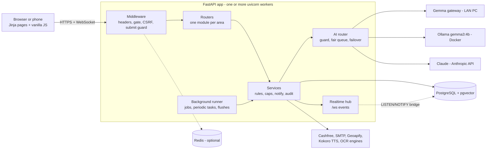
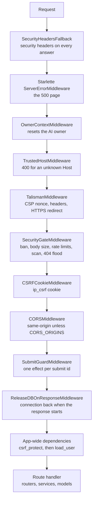
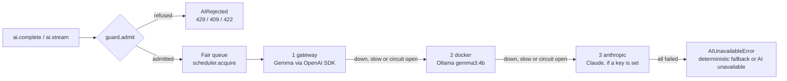

# IronPulse — architecture & engineering contract

> [!WARNING]
> **No liability.** IronPulse is a student-grade project, provided "as is", without warranty of any kind. Nothing in it is medical, legal or financial advice; AI output can be wrong, and the safety features are aids that can miss things - not a guarantee. The authors and contributors accept no liability for any damage arising from using, deploying or modifying it. See the README's [Disclaimer & no liability](README.md#disclaimer--no-liability) and [TERMS.md](TERMS.md).

Student-grade project. Read [README.md](README.md) for setup. This file is the contract every module follows:
[§3](#3-coding-conventions) holds the rules (code comments cite it as "ARCHITECTURE.md §3"), the other sections
explain how the parts fit together. Every user-visible limit is listed in [README "Limits"](README.md#limits).

## Contents

| § | Section | What is in it |
|---|---|---|
| 1 | [Overview](#1-overview) | stack, system diagram, request lifecycle, data model |
| 2 | [Layout & ownership](#2-layout--ownership) | where code lives, foundation files |
| 3 | [Coding conventions](#3-coding-conventions) | the hard rules: async and no N+1, pagination, caps, database limits and sizing, indexes, writes, auth, UI, uploads, AI calls, background work |
| 4 | [Subsystems](#4-subsystems) | AI chain, guard and queue · AI memory · health and trainer safety · sessions · trust & safety · governance · memberships · realtime · static files |
| 5 | [Security model](#5-security-model) | layers, security gate and shared limits, bans, CSRF and sign-in, production mode, LAN mode |
| 6 | [Performance & limits](#6-performance--limits) | what keeps every page and table bounded, load testing |
| 7 | [Testing](#7-testing) | test databases, helpers, the N+1 and limits guards, the bug hunt |
| 8 | [Operations & observability](#8-operations--observability) | starting, logs, health checks, admin consoles |
| 9 | [Decisions & trade-offs](#9-decisions--trade-offs) | why it is built this way |
| 10 | [Business rules](#10-business-rules) | canonical values |
| 11 | [Route map](#11-route-map) | every route, by area and owner |
| 12 | [Cross-package service APIs](#12-cross-package-service-apis) | who provides what to whom |

---

## 1. Overview

IronPulse is one FastAPI application. It renders Jinja2 pages on the server (progressive enhancement), adds small
vanilla-JS components for the live parts, pushes events over one WebSocket (`/ws`) and keeps all durable state in
PostgreSQL (uploaded files on disk under `var/`, private ones encrypted). It runs as one or several uvicorn worker processes, and every process also runs the background runner
(durable jobs, periodic tasks, flush loops). Redis is optional: with `REDIS_URL` the workers share sessions, rate
limits, threat scores, AI quotas, presence and double-submit outcomes; without it each process keeps the same state in
bounded memory. AI is advice: safety- and money-related output is re-checked by deterministic code, and every feature
keeps working when every AI provider is down.

### Stack

| Concern | Choice |
|---|---|
| Web | FastAPI 0.16x + Starlette 1.x, Jinja2 templates (server-rendered, progressive enhancement), uvicorn workers |
| DB | PostgreSQL 15+ with **pgvector**, `citext`, `pg_trgm`; SQLAlchemy 2.x **async** (asyncpg). `manage.py check` warns below 15; the Docker setup uses `pgvector/pgvector:0.8.7-pg17` |
| Shared state | Redis (optional): session cache, shared rate limits and threat scores, AI guard, presence leases, submit-guard outcomes - keys under `ip:<env>:<db>:`; a bounded per-process fallback without it |
| UI | Tailwind CSS v4 (standalone CLI, dark/light via `.dark` class), vanilla JS bundle (no framework) |
| AI | Ordered failover: **Gemma gateway (OpenAI SDK)** → **Gemma in Docker (Ollama `gemma3:4b`, OpenAI SDK)** → **Claude (Anthropic SDK)** → "AI unavailable", behind a per-user guard and a fair queue ([§4](#ai-providers-guard-and-fair-queue)) |
| Embeddings | deterministic local feature hashing (`app/ai/embeddings.py`, 384 dimensions, no model download, works offline) in pgvector columns |
| Voice | Kokoro TTS (OpenAI-compatible `POST /v1/audio/speech`, Docker) for the live coach; the browser's own voice when Kokoro is down |
| OCR | Several engines cross-validate (Tesseract, Apple Vision, Windows OCR, RapidOCR, Gemma/Claude vision) |
| Payments | Cashfree PG (subscriptions) + Cashfree Payouts (salaries); **TEST MODE** simulation when keys are absent |
| Realtime | WebSocket `/ws` (live chat, notifications, AI status) + in-process hub (optional PG LISTEN/NOTIFY bridge) |
| Mail | SMTP via aiosmtplib from a DB outbox; without SMTP mails are written to `var/mail/*.eml` |
| Security | Talisman-style headers + CSP nonce, CSRF (signed double submit bound to session), CORS, TrustedHost, rate limiter, signature scanner, IP bans, Argon2id, Fernet encryption at rest, double-submit guard |
| OS | Windows / macOS / Linux. Paths via `pathlib`, no shell-specific code in Python |

Python 3.10+ compatible code (developed on 3.15). Never use OS-specific APIs without a guard.

### System diagram



### Request lifecycle

Middleware order, outermost first (`app/main.py`):



* `SecurityHeadersFallback` wraps Starlette's own `ServerErrorMiddleware` (`IronPulseApp.build_middleware_stack`), so
  the responses Talisman never sees - the Host check's 400, Talisman's own HTTP->HTTPS redirect and the 500 page - still
  leave with CSP (`default-src 'none'` when Talisman never ran; Talisman's policy and nonce on the 500 page), `nosniff`,
  `X-Frame-Options: DENY`, Referrer-Policy, COOP / CORP, `X-Permitted-Cross-Domain-Policies`, `no-store` and HSTS when
  `FORCE_HTTPS` or `COOKIE_SECURE` is on. A response Talisman decorated passes untouched.
* `OwnerContextMiddleware` resets the AI owner (`app/ai/owner.py`) around every request: httpx's `ASGITransport` runs
  requests inside the test's own task, so without the reset an owner could leak from one request into the next.
* `csrf_protect` runs BEFORE `load_user`: it may read a whole form body (a photo upload from a phone takes seconds), and
  `load_user`'s query opens the request's transaction - read after it, the upload kept a pooled connection idle in that
  transaction (killed after `DB_IDLE_TX_TIMEOUT_MS`). `ReleaseDBOnResponseMiddleware` gives the request's connection
  back when the response starts, not after the last byte reached the client (`app/db.py` `release_request_session`).
* CORS allows GET / POST with credentials, the headers `Content-Type`, `X-CSRF-Token`, `X-Page-Id`, `X-Submit-Id` and a
  10-minute preflight cache; an empty `CORS_ORIGINS` means same-origin only. `/api/docs` and `/api/openapi.json` exist
  only with `DEBUG=true`. `/static` is `CachedStaticFiles` ([Static files and caching](#static-files-and-caching)).
* Routers: every module of `ROUTER_MODULES` (26) exposes `router = APIRouter()`; `SIDE_EFFECT_MODULES`
  (`app.core.nav`, `app.services.accounts`) only register background jobs / periodic tasks / ws handlers.
* Lifespan: under `startup_lock` (one process at a time) `create_all` (`AUTO_CREATE_TABLES`) with the additive schema
  sync (`AUTO_MIGRATE`; never drops anything) and `bootstrap`; then the background runner (`RUN_BACKGROUND_JOBS`; never
  in tests) and, with `REALTIME_PG_BRIDGE`, the LISTEN bridge (`REALTIME_PG_BRIDGE_URL`, else `DATABASE_URL`); then the
  log line `<app> ready on http(s)://host:port (env=...)`. Shutdown: closing sockets stop counting as people leaving,
  the runner stops, running presence callbacks drain (2 s), the bridge stops, the engine is disposed.

### Data model

Every table is declared in `app/models/` - relational, with explicit `ON DELETE` rules and every relationship
`lazy="raise"`. Main tables by domain:

| Domain | Module | Tables |
|---|---|---|
| Accounts & identity | `users.py`, `remembered.py` | `users`, `user_sessions`, `auth_tokens`, `customer_profiles`, `fitness_profiles`, `identity_documents`, `remembered_accounts` |
| Gyms & branches | `gyms.py` | `gyms`, `branches`, `branch_hours`, `branch_features`, `branch_photos`, `branch_documents`, `verification_runs` |
| Billing | `billing.py` | `plans`, `subscriptions`, `transactions`, `otp_challenges`, `salary_statements` |
| Staff & jobs | `staff.py` | `employees`, `employee_documents`, `trainer_shifts`, `trainer_clients`, `job_postings`, `job_enquiries` |
| Health & coaching | `health.py`, `live.py` | `health_conditions`, `metric_entries`, `health_alerts`, `suspension_events`, `wellness_checks`, `workout_plans`, `exercises`, `videos`, `workout_sessions`, `workout_session_events` |
| Engagement | `engagement.py` | `tasks`, `notifications`, `email_outbox`, `chat_threads`, `chat_messages`, `misconduct_reports`, `assistant_messages` |
| Shop | `shop.py` | `products`, `product_images`, `cart_items`, `wishlist_items`, `coupons`, `shop_orders`, `shop_order_items`, `refunds`, `product_reviews`, `inventory_movements` |
| Trust & safety | `trust.py` | `staff_violations`, `account_bans`, `trust_ip_actions`, `blocked_identities` |
| System | `system.py` | `security_events`, `ip_bans`, `audit_logs`, `ai_call_logs`, `jobs` |

* pgvector columns (384-dimension embeddings from `app/ai/embeddings.py`: hashed word unigrams, bigrams and character
  trigrams, L2-normalised, so cosine distance `<=>` behaves like a fuzzy lexical similarity): `products.embedding`
  (HNSW index `ix_products_embedding_hnsw`, shop search), `exercises.embedding` (exercise search),
  `assistant_messages.embedding` (assistant memory recall), `customer_profiles.health_embedding`.
* The exercise library (`app/data/exercises.py`, synced into `exercises`; `contraindications` are safety tags) and the
  video catalogue (`app/data/videos.py`; the MP4s are rendered by `scripts/generate_videos.py`, no AI needed) are code.
* Retention is relational: accounts are soft-deleted for 30 days and then purged with cascades
  ([Accounts & deletion](#accounts--deletion-relational-retention)); fast-growing operational tables are trimmed by the
  nightly retention job ([Background work](#background-work)); `staff_violations` (immutable) and `blocked_identities`
  (keyed hashes, no foreign key to `users`) outlive the account ([Trust & safety](#trust--safety)).

---

## 2. Layout & ownership

```
app/
  main.py  __main__.py  app factory, middleware order, router list / `python -m app` launcher        (foundation)
  config.py  db.py      settings (.env, production checks) / async engine, sessions, QueryCounter,
                        schema sync, connection budget                                             (foundation)
  models/               ALL tables (relational, explicit ON DELETE rules)                          (foundation)
  core/                 templating (render, redirect, flash), deps (auth guards), errors, nav, icons, geo, utils,
                        pagination, caps, submit_guard, static, ttl_cache, state
  security/             talisman, csrf, gate (bans/rate-limit/scan), scanner, ratelimit, bans, net, sessions,
                        passwords, crypto
  ai/                   client.py (router + FakeProvider + SimulatedProvider), guard, scheduler, policy, owner,
                        memory, member_context, safety, jsonutil, embeddings + per-feature AI modules (WPs)
  services/             jobs, worker, notify, mailer, audit, storage, realtime, presence, batching, retention,
                        accounts, subscriptions, visibility, conditions, bootstrap, ocr (iface), id_verification,
                        trust_safety, trainer_safety, remembered_accounts, gym_limits, fitness_profile + WP services
  routers/              one module per work package (see §11)
  templates/            base.html, _ui.html (macros), partials/, errors/, emails/, identity/_fields.html + WP folders
  static/src/js/        00-core, 05-island, 06-theme, 07-geolocate (foundation) + NN-<wp>.js per WP
                        (01-ai, 02-accounts, 08-ask-ai, 10-public ... 80-shop)
  data/                 exercise library and video catalogue (code, synced into the database)
tailwind/input.css      design system; tailwind/wp/<wp>.css per WP
scripts/                manage.py (CLI), make_env, build_assets, init_db, seed_demo, generate_videos, stress_test,
                        check_env, lan.py (LAN mode), ai_fallback.py, dev_watch.py, find_query_loops.py,
                        runtime_postgres.sh, runtime_redis.sh, windows/*.ps1
scripts/demo/           demo dataset (dataset.json = data only) + loader/art used by seed_demo.py - never imported by app/
docker/                 compose.yml, compose.gpu.yml, kokoro.compose.yml, Dockerfile, healthcheck.py
docs/                   ai-guard-and-queue.md (AI guard, queue, presence, memory), load-test-page.md
loadtest/               Locust load-test kit (production mode) - loadtest/README.md
tests/                  conftest (fixtures/helpers), factories, test_<area>.py, n_plus_one_allowlist.json
```

**Foundation files are read-only for work packages.** If a WP truly needs a foundation change, make the
smallest *additive* edit (re-read the file right before editing) and report it.

---

## 3. Coding conventions

The hard rules. Code comments cite this section as "ARCHITECTURE.md §3".

### Async + no N+1 (hard rule)
* Everything is `async def`; blocking work (Pillow, Tesseract, pypdfium2, argon2) goes through `asyncio.to_thread`.
  Images and PDFs are decoded only through the storage helpers ([Uploads](#uploads)).
* Every relationship is `lazy="raise"`. Load related rows explicitly with `selectinload` (collections) or
  `joinedload` (many-to-one / one-to-one). Touching an unloaded relationship raises `InvalidRequestError`.
* List pages must issue a constant number of queries regardless of row count (tests use `app.db.QueryCounter`).
* Aggregates (counts, sums) use SQL (`func.count`, correlated subqueries, `GROUP BY`), never Python loops over lazy data.
* **The N+1 guard** checks every route and every loop ([Testing](#7-testing)): `tests/test_no_n_plus_one.py` measures
  every GET page and GET JSON API as every role on a small and a grown world, and `scripts/find_query_loops.py` lists
  every database call made once per loop iteration in `app/**`. A finding is fixed (one set-based statement, an IN
  list, a join, a bulk INSERT, `notify_bulk`, `enqueue_many`) or allowlisted with its reason in
  `tests/n_plus_one_allowlist.json`.

### Lists & pagination (`app/core/pagination.py`, hard rule)
Every list that grows with the data is bounded **in SQL** (`LIMIT`), never loaded whole and sliced in Python.
```python
from app.core.pagination import keyset, paginate, parse_keyset, parse_page

pr = parse_page(request, default_per_page=25, max_per_page=100)   # ?page= / ?per_page= (junk -> defaults, clamped)
page = await paginate(db, select(Order).where(...).order_by(Order.created_at.desc(), Order.id.desc()),
                      page=pr.page, per_page=pr.per_page)         # COUNT + one LIMIT/OFFSET query = 2 statements
return render(request, "orders.html", {"page": page})             # page.items, .total, .page, .pages, .has_next ...
```
* Template: `{{ ui.pager(page, noun="orders") }}` — Previous · `1 … 4 5 [6] 7 8 … 40` · Next (`Page.window()`; never a
  link per page), keeps every other query parameter of the current request (or pass `params=`/`path=`, or `url=` a
  page-number → href callable), `aria-current="page"`, nothing for a single page. Iterating a `Page` iterates its items.
* `paginate` options: `count_stmt=` (a cheaper COUNT), `count_cap=10_000` (stop counting there: `page.total_capped`,
  the pager shows "10,000+"), `window_count=True` (one query with `count(*) OVER ()`), `unique=True` (joinedload of a
  collection). A page past the end shows the last page. Order by a unique key (`…, Model.id`) and index that ORDER BY.
* Feeds (notifications, chat, activity) use keyset windows, whose cost does not grow with scroll depth:
  `k = parse_keyset(request, 20, 50)` → `await keyset(db, select(ChatMessage).where(ChatMessage.thread_id == tid),
  ChatMessage.id, before_id=k.before_id, after_id=k.after_id, limit=k.limit)` → `.items`, `.has_more`,
  `.next_cursor` (`.meta()` for JSON); index `(thread_id, id)`. With `order_col=Notification.created_at` the window is
  ordered by `(created_at, id)` with the same id cursor — served by `ix_notifications_user_created (user_id, created_at, id)`.
* JSON lists return `page.meta()` / `window.meta()` next to the items; never accept an unbounded `limit`.
* Never bind an unbounded Python list (`IN (:ids)` has a 32,767-parameter ceiling): use a subquery, a set-based
  `UPDATE … FROM`, `= ANY(:array)`, or chunks of ≤ 1,000.
* Facets and teasers that aggregate a whole table on a public page (home figures, featured gyms, the directory's city
  list, shop category counts, top stores) are cached in-process with `app/core/ttl_cache.py`:
  `TTLCache(name, ttl).get_or_compute(key, fn)` - one computation per key at a time (single flight), the stale value
  served while one request refreshes it, a failed computation never cached, values plain data (never ORM objects) - plus
  `clear_on_commit(caches, models)` to clear them when this process commits a change. Other processes see changes within
  the TTL; tests reset every cache.
* Per-member caps: a reader of ONE member's health conditions reads at most `CONDITIONS_READ_MAX` (100) rows in SQL,
  ordered `health.safety_first()` (one row of every tag first, so padding never hides a safety tag); one person holds
  at most `TASKS_MAX_OPEN` (500) open tasks (`TaskLimitError`: the form shows it, the assistant answers it); the month
  grid loads `CALENDAR_DAY_MAX` (15) tasks a day + "+N more" → `/tasks?day=`; `/tasks` is paginated (50 a page).
* Sort keys that would need an expression or an aggregate per row are stored and indexed, so a big list reads an
  index in order instead of sorting every match: `products.in_stock` (STORED generated column, `stock > 0`) and
  `products.rating_avg` / `review_count` (the visible reviews' summary) back the shop's `ix_products_catalogue_*`
  orders. The summary is rewritten in the SAME transaction as every review change: an ORM flush hook in
  `app/services/shop.py` (any module's insert / edit / delete / hide of a `ProductReview`); Core statements and
  `ON DELETE CASCADE` paths call `refresh_product_ratings(db, product_ids)` themselves (the account purge notes its
  members' reviewed products before the DELETE and refreshes them in the same transaction); the hourly
  `shop_product_ratings` periodic (`backfill_product_ratings`, idempotent, 200 products per transaction) is the
  one-off backfill and the safety net. Its row lock is `FOR NO KEY UPDATE` - `FOR UPDATE` would deadlock against the
  `FOR KEY SHARE` a concurrent review's foreign-key check holds on the same product. Index a stored column, never an
  expression over a hot column: a stock change that keeps `in_stock` stays a HOT update, while an expression index
  on `(stock > 0)` would make every sale rewrite every index of products (HNSW ~5 ms a row at 100,000 products).
  Adding `in_stock` to an existing database rewrites `products` under an exclusive lock and rebuilds its indexes:
  123 s at 100,000 products, 2 s of it without the HNSW index. On a large catalogue run
  `DROP INDEX CONCURRENTLY ix_products_embedding_hnsw` first (search stays correct, slower), let the schema sync add
  the columns, then `create_indexes_concurrently()` rebuilds HNSW without blocking writes.

### Caps and limits (`app/core/caps.py`)
* Nothing a person, gym, branch, product or posting creates grows without bound. Every cap is one row of ONE table,
  `caps.CAPS` (name, value, wording, scope). A cap with a `setting` (e.g. `MAX_ONLINE_GYMS`) reads it; every other cap
  can be overridden with `CAPS_OVERRIDES` (`branches_per_gym=300,products_per_gym=5000`; unknown names and bad values are
  ignored, logged once).
* Every create path uses the one race-safe check:
  `await caps.enforce(db, "branches_per_gym", gym.id, select(Branch.id).where(Branch.gym_id == gym.id))`. It takes a
  transaction-scoped advisory lock on (cap name, scope id) - held until the caller's COMMIT / ROLLBACK, so the caller
  inserts in the SAME transaction - and only then counts, in its own statement, whose READ COMMITTED snapshot sees every
  row a previous lock holder committed: N parallel requests can never pass the cap together. The count reads at most
  `limit + adding` rows of the scope. Storage quotas use `caps.enforce_bytes`.
* A refusal is `CapReached`: an `HTTPException` (409, or 429 for a per-day cap) whose `detail` is a friendly sentence.
  Routes with a form catch it and show `str(exc)` next to the field, JSON routes return `exc.payload()`, and an uncaught
  one still answers with the friendly error page / `{"error", "detail"}` JSON of `app/core/errors.py` - never a 500.
* Lock order: a narrower cap (a product's photos) before a broader one (the gym's storage), never the reverse, so two
  caps can never deadlock; a per-person lock comes before any transaction or subscription row lock
  (`gym_limits.lock`: person → transaction → subscription).
* Other race-safe limits follow the same idea - lock first, then count or write: the 50 health items per member behind
  a per-member advisory lock (`health.lock_conditions`), the fitness profile behind its row's `SELECT ... FOR UPDATE`
  (CHECK constraints as the backstop), job enquiries behind a per-posting advisory lock, remembered accounts behind the
  account's sign-in lock.
* Every user-visible limit (page sizes, caps, "N+" counts, cache TTLs, windows) is a module constant or a setting and
  has a row in [README "Limits"](README.md#limits) (what, value, where to change it); `tests/test_limits_docs.py` reads
  each value from the code and fails when a row disagrees, and `tests/test_caps.py` requires a row for every cap of
  `CAPS` - add the row and its check with every new limit.

### Database limits
`app/db.py`:
* Every pooled connection runs with `statement_timeout` = `DB_STATEMENT_TIMEOUT_MS` (15 s) and
  `idle_in_transaction_session_timeout` = `DB_IDLE_TX_TIMEOUT_MS` (60 s); waiting for a pooled connection is capped at
  `DB_POOL_TIMEOUT_S` (10 s). In a request, a cancelled statement or an exhausted pool becomes a 503 "This page is
  taking too long - please try again" (JSON `code: "timeout"` for /api, HTML otherwise; logged with the route).
* Background transactions (`session_scope()`: jobs, periodic tasks, worker loops, scripts) may stay idle up to
  `DB_BACKGROUND_IDLE_TX_TIMEOUT_MS` (10 min, e.g. a job that read its rows while the AI answers) — better still,
  commit or close the session before a long AI / OCR call (request handlers must: 60 s). Under `ENVIRONMENT=test`
  the idle limit defaults to 1 h (a test's `db` fixture session spans all its requests) unless set explicitly.
* Work that legitimately needs longer statements raises the limit for its own transaction only:
  `await long_statement(db, ms)` (`SET LOCAL statement_timeout`; default `DB_LONG_STATEMENT_TIMEOUT_MS`, 0 = none;
  `idle_ms=` for a stream waiting on a slow client). Call it again after each commit. Batch jobs commit per chunk.
* New indexes on large existing tables: `sync_schema` builds missing indexes at startup with a plain (locking)
  `CREATE INDEX`. On production data build them first, without blocking writes, with
  `python -c "import asyncio, app.db as d; print(asyncio.run(d.create_indexes_concurrently()))"` (every declared but
  missing index, `CREATE INDEX CONCURRENTLY`; invalid leftovers rebuilt), then deploy — `sync_schema` skips them.
* Start-up: `create_all` / `sync_schema` and the bootstrap run under `startup_lock` (a session-level advisory lock on a
  connection of its own) - workers starting together apply the schema one at a time instead of racing into
  UniqueViolations. Periodic tasks (`run_periodic`) hold their lock the same way, on an autocommit connection of its
  own, so a task may commit as often as it likes without another process starting the same task.
* A request gives its connection back when the response STARTS (`ReleaseDBOnResponseMiddleware` +
  `release_request_session`), not after the last byte of the body; app-wide dependencies run `csrf_protect` (which
  reads a form body) before `load_user` opens the request's first transaction, and `lookup_session` commits its read
  before warming Redis. The mailer claims its batch (`SENDING` + a lease) in one statement, commits, and talks to the
  SMTP server outside any transaction.

### Database sizing
Several workers, `app/db.py`:
* Every worker process has its own pool, shared by its requests and its background work (jobs, periodic tasks, worker
  loops): at most `DB_POOL_SIZE` + `DB_MAX_OVERFLOW` connections, plus one LISTEN connection with `REALTIME_PG_BRIDGE`
  (several workers). The app opens at most **workers × (DB_POOL_SIZE + DB_MAX_OVERFLOW + 1)** connections; PostgreSQL
  accepts `max_connections` − `superuser_reserved_connections` (− `reserved_connections`, PostgreSQL 16+) = 100 − 3 =
  97 by default, and a database's / role's `CONNECTION LIMIT`; beyond that it refuses new ones ("too many clients").
* Defaults `DB_POOL_SIZE=10`, `DB_MAX_OVERFLOW=5`: 4 workers × (10 + 5 + 1) = 64 of 97, under the 80 % (77) the
  startup check allows; the other 33 stay free for psql, `create_indexes_concurrently()`, backups, monitoring,
  `manage.py` scripts and a development server on the same PostgreSQL (a fifth worker, 80, warns). 15 per worker is
  plenty: a request holds a connection only while its transaction is open (milliseconds for a page; handlers commit
  before slow AI / OCR calls), and background work takes a few while it runs (`JOBS_CONCURRENCY` jobs, periodic tasks,
  the worker loops), so 10 or so stay for requests, which serve far more concurrent visitors than that. The old 10 + 20
  needed 4 × 31 = 124. An older `.env` may still pin `DB_MAX_OVERFLOW=20`.
* Overload: when every connection of a worker is busy, a request waits in the pool up to `DB_POOL_TIMEOUT_S` (10 s),
  then gets the friendly 503 ("taking too long - please try again", `Retry-After: 5`). A connection PostgreSQL
  refuses anyway (SQLSTATE 53300 / 57P03) is the same 503, never a 500 (`db_timeout_kind`).
* Overload outside a request degrades quietly - no traceback, one WARNING per call site per minute with how many more
  were held back (`app/core/overload.py`), for what `db_unavailable` calls unavailable (pool timeout, refused or lost
  connection - never a slow statement of a job, nor a bug):
  * `/ws`: the session check (or its re-check) accepts and closes the socket with **1013** "try again later"; the page
    reconnects after a jittered back-off (1-3 s, doubling to 10-30 s; a `hello` starts over - `00-core.js`), well
    inside the presence grace period.
  * presence: the database step of a return (resume paused jobs), an exit (exit policies) or a sign-out (any other
    live session?) is deferred and retried by the presence sweeper (5 s doubling to 60 s, one probe a round, at most
    100 users a round), each retry judged on the state of then: never dropped.
  * the job runner: a run cut short is queued again for 30 s with its attempt given back (an overload never uses up a
    job's attempts); a final status write keeps trying for 2 minutes before it leaves the row to the stale-job
    reclaim. The worker loops back off (their interval doubled per failure, at most 30 s); jobs and e-mails stay
    queued meanwhile.
  * a client that went away is no error: `ClientDisconnect` while its body was read is one DEBUG line (status 499,
    never sent), and the ROLLBACK that gives a request's connection back when its response starts is shielded from
    the cancellation of a client that leaves (`release_request_session`); SQLAlchemy's "Exception terminating
    connection" of a cancelled task is one DEBUG line.
* Worker count: `IRONPULSE_WORKERS` (`python -m app` sets it from `WEB_CONCURRENCY`, `loadtest/run_server.sh` from its
  `--workers`), else `--workers N` on the uvicorn command line (`manage.py run --workers N` starts that), else
  `UVICORN_WORKERS`, else `WEB_CONCURRENCY`, else 1 (`--reload`: 1).
* Startup check (`ConnectionBudget`): the first connection each process's pool opens reads `max_connections`, the
  reserved slots and the database's / role's `CONNECTION LIMIT` (one query) and logs `database connection budget: ...`
  at INFO, or a WARNING with the formula and the limit it breaks when the workers' pools exceed 80 % of the server's
  slots (`BUDGET_SHARE`) or a `CONNECTION LIMIT`. It never stops the start. Fix: lower `DB_POOL_SIZE` /
  `DB_MAX_OVERFLOW`, run fewer workers, raise `max_connections` (every server connection is a process with its own
  memory, plus `work_mem` per sort) or put PgBouncer in front.
* PgBouncer (several app servers, or more workers than one PostgreSQL has slots for): version ≥ 1.21 in transaction
  mode (`pool_mode = transaction`; `max_prepared_statements` > 0, e.g. 200 — asyncpg prepares every statement). The
  pools then count against PgBouncer's `max_client_conn`; only `default_pool_size` server connections reach
  PostgreSQL. Everything the app does per transaction keeps working (`SET LOCAL` / `long_statement`, advisory xact
  locks, `FOR UPDATE SKIP LOCKED`), but PgBouncer refuses the limits sent at connect time: add
  `ignore_startup_parameters = statement_timeout,idle_in_transaction_session_timeout` and set them on the role instead
  (`ALTER ROLE ironpulse SET statement_timeout = '15s'`, `... SET idle_in_transaction_session_timeout = '60s'`).
  LISTEN does not work through transaction pooling: with several workers point `REALTIME_PG_BRIDGE_URL` at a direct
  (session-pooled) PostgreSQL URL for the bridge - left empty, the bridge uses `DATABASE_URL`, which must then reach
  PostgreSQL itself (or PgBouncer in session mode, which saves nothing). Run scripts that change session settings
  (`create_indexes_concurrently()`) against PostgreSQL directly.

### Indexes and query shapes (`app/models/*`)
* Every index is declared on its model (`__table_args__`), so `create_all`, `sync_schema` and
  `create_indexes_concurrently()` build it, and an EXPLAIN test checks it against the statement its page really sends
  (captured with its parameters on a seeded database): `tests/test_cleanup_indexes.py`, `test_finance_scale.py`,
  `test_shop_sort_columns.py`, `test_jobs_near_me.py`, `test_job_enquiry_spam.py`, `test_tasks_bounds.py`.
* The load-safety cleanup added: chat_threads `(customer_id | employee_id | gym_id, coalesce(last_message_at,
  created_at) DESC, id DESC)` (the list's ORDER BY); employees `(updated_at, id) WHERE verification_status =
  'needs_review'` (review queue + badge); trigram GIN on users `full_name`, `email::text`, `username::text`,
  `phone_normalized` and on email_outbox `to_email`, `subject`; audit_logs `(gym_id, created_at, id)` and `(actor_id,
  created_at, id)`; ip_bans `lifted_at`, auth_tokens `used_at` / `expires_at WHERE used_at IS NULL` (retention);
  transactions `(gym_id, coalesce(completed_at, created_at) DESC, id DESC)`, `(direction, status, booked)` and the
  payment-proof sha256 (partial expression); products `ix_products_catalogue_*` (one per catalogue sort, `WHERE
  is_active`); job_postings `(created_at DESC, id DESC) INCLUDE (gym_id) WHERE is_open`; job_enquiries `(job_id,
  created_at DESC, id DESC)`; tasks `(user_id, coalesce(due_at, remind_at), id) WHERE completed_at IS NULL` (a
  person's open tasks in /tasks order, never their completed history).
* A composite index that leads with a foreign key replaces that column's single-column index (it serves the
  `ON DELETE` lookups too): the model names the old index in its table info (`superseded_indexes`) and
  `create_indexes_concurrently()` drops it (`DROP INDEX CONCURRENTLY`) once the replacement is valid; `sync_schema`
  never drops anything.
* The statement must have the index's shape:
  - a list over several parents (an owner's gyms, a staff member's employments) reads each parent's newest window
    through `LATERAL (... ORDER BY ... LIMIT n)` and merges them (`chat._window_ids`, the owner's transactions per
    gym): `parent_id IN (subquery) ORDER BY ... LIMIT n` sorts every row of every parent for each window;
  - citext columns are compared as text (`cast(User.email, Text).ilike(...)`): citext's own ILIKE uses no trigram
    index, so one such arm turns an OR search into a scan of every user;
  - never OR a scope next to a filter that already implies it (`owner_audit`: a gym of the owner, or "my actions"):
    the OR makes an ordered index range a BitmapOr of every scoped row plus a sort.
* Deploying new indexes to an existing database (or before a load test on an already-seeded one): run
  `create_indexes_concurrently()` first (see [Database limits](#database-limits)); otherwise every worker builds them at
  startup with a locking `CREATE INDEX`.
* A new UNIQUE index over data an old race may have duplicated names the SQL that makes the rows fit in its table's
  `info` (`app.db.BEFORE_UNIQUE_INDEX`, e.g. `uq_misconduct_reports_one_open` closes the newer duplicate open reports,
  saying so): `sync_schema` runs it in the same savepoint as the `CREATE INDEX`, `create_indexes_concurrently` right
  before the build. It must be idempotent.

### Database writes
* Request handlers receive `db: DB` (from `app.core.deps`) and call `await db.commit()` explicitly.
* Hard deletes: Core `delete(Model).where(...)` — FK `ON DELETE` rules do the cascading (passive deletes).
* Money: `Decimal` + `Numeric(…, 2)`; format with `money(amount, currency)`. Never float for money.
* Times: store UTC `timestamptz`; display with the `dt` filter (user's time zone). Dates per local tz: `local_today(tz)`.

### Accounts & deletion (relational retention)
* Deleting a customer/staff account is a **soft delete** (`app.services.accounts.soft_delete_user`): data stays
  30 days (shown as "Deleted user" — use `user.display_name`, `employee.display_name`), then the hourly purge
  hard-deletes it (CASCADE) and wipes files. During the window the e-mail **and phone** stay reserved:
  call `identifier_conflict(db, email=..., phone=..., country_code=...)` in every signup/profile/registration form.
* After a deletion or a ban the identifiers stay blocked for good: `identifier_conflict` also asks
  `trust_safety.registration_blocked` (keyed hashes in `blocked_identities`, [Trust & safety](#trust--safety)), so every
  path that checks identifiers refuses them with a neutral message.
* Store phones as typed in `phone` and E.164 in `phone_normalized` (`normalize_phone`).
* Never show or act on deleted users (filter `User.deleted_at.is_(None)`) except to render history labels.

### Auth & authorization
* Dependencies (`app.core.deps`): `CurrentUser`, `AuthUser`, `OwnerUser`, `StaffUser`, `CustomerUser`, `SuperAdminUser`.
* Scope every owner query by ownership: `get_owned_gym / get_owned_branch / get_owned_employee` (404 on foreign IDs).
* An owner reaches a member (profile, health record, safety panel) only through `intake.related_customers_clause` /
  `is_related` / `profiles.access_level`: a current or member-consented membership at one of their gyms
  (`intake.consented_subscription_clause`: active or suspended, a purchase the member started in their own app, or one
  that expired within `FORMER_MEMBER_DAYS`) or a member they registered - the same rule as `checkout.desk_consent`.
  A cancelled membership, a desk purchase that never became one or an old expiry gives nothing (404).
* Profile pages (`app/services/profiles.py`): access levels `self` > `admin` > `manager` (an owner of a gym the person
  belongs to) > `trainer` (an active assigned trainer - a one-line notice instead of health details when the member
  switched off sharing) > `public` (owners and active staff, who appear on gym pages) > `none` (members are private:
  404, existence not revealed). Who may see health details is defined once more strictly for trainer-facing pages
  ([Health safety and trainer safety](#health-safety-and-trainer-safety)).
* Path ids are bounded (`IdParam`: 1 … 2⁶³-1, a 422 page); anything else that reaches the database out of the 64-bit
  range is answered 404 by `app/core/errors.py` (`id_out_of_range`), never a 500.
* Staff see only their own employments' data; customers only their own.
* `request.state.user` has `customer_profile` eagerly loaded (None for non-customers).

### Templates & UI
* Handlers return `render(request, "folder/page.html", {...})` or `redirect(url, message, category)`.
  Categories: `success`, `error`, `warning`, `info`.
* ``, blocks: `title`, `content`, `head`, `scripts`, `main_class`.
* `` → `ui.page_header`, `ui.field`, `ui.select`, `ui.textarea`,
  `ui.checkbox`, `ui.file`, `ui.button`, `ui.status`, `ui.badge`, `ui.stat`, `ui.empty`, `ui.avatar`, `ui.alert`,
  `ui.form_errors`, `ui.confirm_button`, `ui.csrf`, `ui.ai_chip`, `ui.pager` (see Lists & pagination). Icons:
  `{{ icon("name", "size-5") }}` (see `app/core/icons.py`).
* Design language: Apple-like — `card`, `card-flat`, `card-muted`, `glass`, `btn btn-primary|secondary|ghost|danger|success|dark`,
  `input`, `label`, `badge badge-green|amber|red|blue|zinc|violet`, `table-wrap`+`table`, `tabs`/`tab`/`tab-active`,
  `eyebrow`, `kpi`, `muted`, `gradient-text`, `hero-gradient`. Always provide `dark:` variants for custom colours.
  Rounded (`rounded-2xl`/`[28px]`), generous spacing, subtle motion (`animate-fade-up`, `ease-spring`).
* Every POST form: `{{ ui.csrf() }}` (multipart forms too: `enctype="multipart/form-data"`). The macro also renders the
  form's one-time `submit_id` (a new one per render) for the double-submit guard, so the guard works without JavaScript.
* Pages with AI features set `ai_feature=True` in the context (shows the "AI unavailable" banner when offline)
  and show `{{ ui.ai_chip() }}`.
* Responsive (mobile first), accessible (labels, `aria-*`, focus states), no horizontal scroll at 375 px.

### JavaScript & CSP (strict)
* **No inline `<script>` bodies, no `onclick=`, no `style=""` attributes.** CSP blocks them. Use a JS file
  `app/static/src/js/NN-<wp>.js` registering components: `IP.register("name", el => {...})`, markup
  `data-component="name"`. Pass data with `data-*` attributes (`{{ value | jsonattr }}` for JSON).
* Dynamic styles via CSSOM (`el.style.width = "40%"`) are allowed. Build DOM with `IP.h(...)` / `textContent`
  (never `innerHTML` with user data).
* `IP.api(url, {method, json|form})` adds `X-CSRF-Token`; throws `Error` with `.status`, `.data`. It also sends the
  tab's `X-Page-Id` on every same-origin request (the AI work of a closed tab is cancelled by it) and a fresh
  `X-Submit-Id` on every unsafe call; a submitted form's buttons show "Please wait…" until the answer arrives.
* Live events: `IP.on("notification" | "chat.message" | "chat.typing" | "ai.status" | "hello", fn)`;
  send with `IP.ws.send({...})`. Toasts: `IP.island.notify({title, body, tone, link})`.
* External scripts: only same-origin files (Leaflet is vendored at `/static/vendor/leaflet/`); Cashfree SDK is
  allowed by CSP only when Cashfree keys are configured.

### Uploads
* Always through `app.services.storage`: `save_public_image` (photos shown publicly; EXIF stripped) or
  `save_private_file` (documents/ID cards; encrypted; returns plaintext for immediate OCR). Catch
  `storage.UploadError` and show its message. Serve private files only through an authorised route using
  `load_private` with `Content-Disposition: inline` and `Cache-Control: no-store`.
* Every upload is size-limited (`MAX_UPLOAD_MB`) and content-sniffed; images are decoded and re-encoded (metadata
  stripped, polyglots defeated). Keys are random UUIDs (`public/...` served by `/media/public/...`, `private/...`
  Fernet-encrypted at rest), so user input never becomes a filesystem path.
* Staff and admin (owner) **photos are compulsory**; ID cards are compulsory for every role except super-admin.
* Every image the server decodes - uploads, health and wellness photos (`health.normalize_photo`), OCR input
  (`ocr._normalise_image`), AI vision input (`ai.client.prepare_image`) - goes through `storage.decode_image` (pixel
  count checked on the header before any pixel is decoded: `MAX_IMAGE_PIXELS` as decoded, a single-scan JPEG up to
  `MAX_JPEG_PIXELS` decoded at 1/2-1/8 scale - Pillow's own MAX_IMAGE_PIXELS merely warns below twice its value)
  inside `storage.run_image_decode` (at most `IMAGE_DECODE_SLOTS` decodes per process; the next waits at most
  `IMAGE_DECODE_WAIT_SECONDS`). PDFium is not thread-safe: every PDFium call holds `storage.PDFIUM_LOCK`, and a page is
  rendered at `storage.pdf_render_scale(...)` (the bitmap stays within `MAX_IMAGE_PIXELS`).
* PDFs with JavaScript, launch actions, embedded files or XFA forms are refused - judged on the names as PDF readers
  decode them (`#xx` escapes), in the file as uploaded AND as PDFium re-writes it (object streams unpacked), plus
  PDFium's own count of document scripts and attachments (`_validate_pdf`); at most `PDF_MAX_PAGES` pages.
* Uploads count against the storage caps (`storage_mb_per_gym`, `storage_mb_per_member`, `caps.enforce_bytes`): an
  upload that would pass one is refused and its file removed.

### Notifications, e-mail, audit
* Every user-facing event and every account change: `await notify(db, user, title, body, category=…, severity=…, link=…)`
  → in-app (live via WebSocket after commit) **and** e-mail (+ guardian CC for minors).
* People without an account (invites, job applicants): `email_address(db, to, title, body, link=…)`.
* Sensitive actions: `await audit(db, actor, "area.action", "entity", id, gym_id=…, detail={…}, request=request)`.

### AI usage
```python
from app.ai.client import ai, AIUnavailableError
from app.ai.errors import AIRejected
try:
    res = await ai.complete(feature="coach", system=SYSTEM, prompt=prompt, schema=PlanModel, images=[...], max_tokens=1200,
                            user_text=what_the_person_typed)   # the guard's duplicate/spam checks read only this
    plan = res.data            # validated Pydantic object; res.provider = "gateway" | "docker" | "anthropic"
                               # (or "simulated": load tests / bug hunts only - AI_PROVIDER_ORDER=simulated)
except AIRejected as exc:
    if exc.code != "busy":
        raise                   # quota/cooldown/duplicate/spam: the app answers 429/409/422 + Retry-After
    ...                         # 'busy' (AI queue full): the deterministic fallback, worded "AI is busy"
except AIUnavailableError:
    ...                         # deterministic fallback or "AI unavailable" UI - never crash
```
* Per-user quotas, spam checks and the fair AI queue: [docs/ai-guard-and-queue.md](docs/ai-guard-and-queue.md)
  (section 11 lists every feature's refusal / busy / leaving behaviour). `AIRejected` and `AICancelled` subclass
  `AIUnavailableError`, so a bare `except AIUnavailableError` would hide refusals. Work queued as a job is not judged by
  the guard: call `await guard.admit(current_owner(), "<feature>")` at the click, then `enqueue(..., user_id=user.id)`.
* Provider failover, costs and the queue are described in [AI providers, guard and fair queue](#ai-providers-guard-and-fair-queue).
* A prompt that is about a member gets the member's profile from `load_member_context` - the ONE builder
  ([AI memory and the member context](#ai-memory-and-the-member-context)) - never from ad-hoc queries.
* An OCR engine step refused by the AI guard (`vision_llm`) keeps the refusal on its `OcrEngineResult.refusal`, so a
  scan admitted at the click but refused in a race still tells the member why (the guard's words), never a silent
  engine failure.
* Gemma context is 8k tokens: keep prompts compact, `max_tokens` ≤ 1500.
* AI output is **advice**: deterministic code re-validates anything safety- or money-related
  (exercise contraindications, payroll arithmetic, suspension thresholds, ID validation).
* Treat user text as data in prompts ("The following is user-provided content…"); never let AI output
  trigger privileged actions without server-side permission checks.
* Tests use `fake_ai(responses=[...] | handler=fn)` / `ai_down` fixtures — never the network.

### OCR / identity
* `app.services.ocr.run_ocr(image_bytes) / ocr_document(data, content_type)` → `MultiOcrResult`
  (`.results`, `.ok_results`, `.best_text`, `.combined_text`, `.engines_used`). Engines never raise.
* `app.services.id_verification.submit_identity_document(db, user=…, employee=None, doc_type=…, country_code=…,
  front=UploadFile, back=UploadFile|None, uploaded_by=…)` stores encrypted images, sets `id_status=PENDING`,
  queues `verify_identity`. Embed the upload fields with ``
  → `{{ idf.id_fields(prefix="id", default_country="IN") }}` (posts `id_doc_type`, `id_country`, `id_front`, `id_back`).
* `id_requirement_met(user.id_status)` gates memberships, staff activation and gym publication.

### Background work
* Durable jobs: `await enqueue(db, "kind", {...}, dedupe_key="kind:id", user_id=…)` + `@job_handler("kind", on_exit=…)`
  (retries with back-off). `on_exit` (pause | cancel | keep) says what happens when the requester leaves; the
  requester gets `task.update` WebSocket events (docs/ai-guard-and-queue.md section 6).
* Periodic: `@periodic("name", every_seconds=60)` (advisory-locked, one process at a time). Process growing sets in
  chunks (`LIMIT n` / keyset, commit per chunk, `long_statement` per chunk transaction), never "load everything".
  `app/services/batching.py` is the shared pattern: `chunks = Chunks(holder=db)` (the periodic's lock session keeps
  its lock; `await chunks.next()` lifts its idle limit before chunk 2 and stops at the time budget), each chunk in its
  own `session_scope()` transaction, `chunks.done(scanned, batch)`; `slices(items, 500)` for bounded `IN` lists.
* AI / OCR in a job: read what it needs, commit (no transaction or row lock is held while a provider answers), call,
  then reopen, lock the row `FOR UPDATE` and write only if it is still what was read - a change made meanwhile wins or
  is processed again (payroll explanations, payment-proof checks, certificate checks).
* Work over all of an owner's gyms is a deduped job, one gym per short transaction with its progress (a retry resumes),
  never a request loop: "Run payroll" for several gyms (`payroll.queue_owner_generation` / `run_owner_generation`,
  `task.update` progress, a notice at the end); the monthly run commits each gym on its own too.
* Fan-out notices: `notify_bulk(db, [Note(...)])` / `notify_many(db, users, title, body)` (app/services/notify.py:
  the same rules as `notify()`, a constant number of statements per 500 recipients) - never `notify()` in a loop over
  a growing audience; a whole gym's members are notified by a `notify_members` job (`member_notices.queue_member_notice`).
* Data retention (`app/services/retention.py`, `@periodic("data_retention")`, hourly tick, acts once per UTC day from
  `RETENTION_HOUR_UTC`): deletes in batches of `RETENTION_BATCH` rows per transaction — security_events >
  `RETENTION_SECURITY_DAYS` (90), audit_logs > `RETENTION_AUDIT_DAYS` (365), ai_call_logs > `RETENTION_AI_LOG_DAYS`
  (30), sent/logged/failed email_outbox > `RETENTION_EMAIL_DAYS` (30), done/failed/cancelled jobs >
  `RETENTION_JOBS_DAYS` (14), read notifications > `RETENTION_NOTIFICATION_DAYS` (90), ip_bans lifted / expired >
  `RETENTION_IP_BAN_DAYS` (90; never an active or permanent ban, never inside the 30-day repeat-offence window),
  auth_tokens used / superseded and unused e-mail-verification / password-reset links expired >
  `RETENTION_AUTH_TOKEN_DAYS` (30; an unused invite stays: the owner pages show "invite sent" from it), user_sessions
  expired > `RETENTION_SESSION_DAYS` (30); 0 keeps a table. Each finished run is a `system.retention` audit row (a run
  that uses up its time budget records nothing, so the next tick carries on). A page must not depend on rows older
  than these windows.
* WebSocket client messages: `@ws_handler("chat.typing")` in `app.routers.core`.
* "Is this user online?" across worker processes: `await hub.online_anywhere(user_ids)` (this process's sockets, then
  one pipelined read of the other workers' presence leases in Redis); without Redis, on a Redis error or with one
  process it answers from this process - an extra e-mail rather than a missed one (chat's message notifications).
* The module defining handlers must be imported at startup: import it from your router module.
* Realtime push to users after commit: `publish_after_commit(db, [user_ids], {"type": "...", ...})`.

The background runner (`app/services/worker.py`, started by the lifespan, disabled in tests) runs these loops in every
process:

| Loop | Every | What it does |
|---|---|---|
| `jobs` | 2 s | starts due jobs in free slots (`JOBS_CONCURRENCY`, 2 per process); never waits for them |
| `job-watchdog` | 2 s | job heartbeats and cross-process stop detection |
| `presence-leases` | 15 s | refreshes this process's Redis presence leases |
| `security-flush` | 2 s | `flush_security_queue`, then `flush_ai_call_logs` - each in its own transaction |
| `ban-sync` | 30 s | picks up other workers' bans and lifts from `ip_bans` |
| `email` | 5 s | `send_pending_emails` (claimed batches with a lease) |
| `ai-health` | `AI_HEALTH_INTERVAL_SECONDS` (60 s) | refreshes provider status; a change is logged and pushed as `ai.status` |
| `periodic:<name>` | per task | every `@periodic` task, under its advisory lock |

Periodic tasks: `refresh_nav_state`, `task_reminders`, `bedtime_reminders` (60 s); `identity_sweep`,
`staff_activation_sweep`, `security_triage` (5 min); `shop_expire_unpaid` (30 min); `purge_deleted_accounts`,
`subscriptions_daily`, `payroll_monthly_generation`, `payroll_salary_reminders`, `shop_product_ratings`,
`shop_low_stock_digest` (1 h); `data_retention` (1 h tick, once per UTC day). Job kinds by exit policy: `pause`
(deferred while the member is away, resumed on return) - `coach_plan`, `health_ai_note`, `health_ac_note`; `keep`
(obligations and system work, always finished) - `verify_identity`, `verify_branch`, `verify_payment_proof`,
`payroll_explain`, `payroll_generate`, `staff_activation_check`, `notify_members`.

---

## 4. Subsystems

### AI providers, guard and fair queue



Every call goes through `app/ai/client.py`, attributed to an owner (`current_owner()`: `load_user` sets one per
signed-in request - user, role, session hash, client IP, the tab's `X-Page-Id`, a disconnect probe; the job runner one
per job; periodic/system work has none), in this order (contract: docs/ai-guard-and-queue.md section 4):

1. **`guard.admit`** (`app/ai/guard.py`) - before any compute: an active cooldown → `cooldown`; text checks on the
   user's raw words (longer than `MAX_TEXT_CHARS` 4,000, repeated characters or words, link floods, mostly symbols →
   `spam`; prompt-injection phrases are noted - a strike and a log line - never refused); the same normalised text for
   the same feature and dedupe scope (`gym:12`, `product:7`) within `policy.dedupe_seconds` → `duplicate`; the
   minute / hour / day quota windows (`policy.cost` units, tier from role + AI plan) → `quota`. Safety features
   (`policy.safety`) skip all four - a health alarm is never refused - but are still counted; `reserve` / `release`
   bound work the quotas never refuse (the AI safety reviews of health readings: past the daily allowance the rules
   decide alone). Every refusal earns strike points (rolling `STRIKE_WINDOW`, 15 min; 5 refusals within 10 s add a
   flood strike; the first 2 duplicates and 5 abandoned answers are free); `COOLDOWN_LADDER` 6 / 12 / 20 points pause
   the account's AI for 2 / 15 / 60 min, the 3rd pause in a day lasts 24 h, and long pauses are reported once to the
   IP threat system. State: Redis (`ip:<env>:<db>:ai:`, one pipelined round trip on the common path, the cached AI
   entitlement read with its version so a subscription change is seen at the next request) or an in-process store with
   the same semantics - the limits never fail open. `admit` judges in a task of its own that the caller's
   cancellation cannot interrupt.
2. **`scheduler.acquire`** (`app/ai/scheduler.py`, per process) - lanes `llm` (`AI_QUEUE_CONCURRENCY`, 4 at once) and
   `tts` (`AI_TTS_CONCURRENCY`, 2); priorities REALTIME < INTERACTIVE < BACKGROUND (background work that waited longer
   than `AGEING_SECONDS` competes as interactive); inside a priority the least recently served bucket (one user's
   requests, one user's jobs, or the system) goes first, FIFO inside a bucket; at most `MAX_RUNNING_PER_USER` (2)
   running per user and lane. User requests are refused early - `too_many` at `AI_QUEUE_MAX_PER_USER` (4) queued +
   running, `busy` at `AI_QUEUE_MAX_TOTAL` (200) in the lane or after `max_wait`; jobs and system work always wait;
   safety features are never refused. `cancel(...)` stops queued and running tickets (work with exit policy `keep` -
   safety checks, verification, payroll, security - only when named explicitly). A signed-in user whose ticket waits
   longer than `ANNOUNCE_AFTER` gets `ai.queue` events (position + ETA). `snapshot()` feeds `/superadmin/ai`.
3. **The providers**, strictly in `AI_PROVIDER_ORDER` (default `gateway,docker,anthropic`): `gateway` - Gemma behind an
   OpenAI-compatible llama.cpp gateway (`AI_GATEWAY_BASE_URL`, default `http://192.168.0.101:8000/v1`, model `gemma`,
   `AI_GATEWAY_MAX_CONCURRENCY` 4); `docker` - Ollama `gemma3:4b` at `http://localhost:11434/v1`
   (`AI_DOCKER_MAX_CONCURRENCY` 1); `anthropic` - Claude through the Anthropic SDK, only with `ANTHROPIC_API_KEY`
   (`ANTHROPIC_MODEL`, default `claude-opus-5-5`). `simulated` (realistic latency, no model) is used only when named in
   `AI_PROVIDER_ORDER` - in production only alone and with `AI_SIMULATED_ALLOWED=true`; `FakeProvider` serves tests.
   `complete()` runs in a child task the queue can cancel; `stream()` checks the ticket between chunks.
4. **`finally`** - release the ticket, `guard.settle`, and a `CallLog` row (`ai_call_logs`: feature, provider, model,
   ok, latency, error, user, owner kind, queue time, cancelled), flushed every 2 s (`CALL_LOG_FLUSH_MAX` 500 per flush).

* Failover (README "Local fallback LLM"): a provider that is down (connection refused, or no TCP connection within
  `CONNECT_TIMEOUT_SECONDS`, 2 s; `CLOUD_CONNECT_TIMEOUT_SECONDS` 5 s for Claude; setting
  `AI_CONNECT_TIMEOUT_SECONDS`), erroring (HTTP 5xx), malformed (bad JSON, broken SSE) or slower than the first-token
  deadline is skipped for the next one. A stream that breaks before its first words moves on, one that breaks after
  them ends with `INTERRUPTED_MARKER` and `meta['truncated']` (an answer cut at `max_tokens` with `CUT_MARKER`) - never
  spliced with another provider's answer. Failures (mid-answer breaks included) open a per-provider circuit breaker:
  `AI_CIRCUIT_FAILURES` (2) in a row skip the provider for `AI_CIRCUIT_COOLDOWN_SECONDS` (45 s), then the next call tries
  it again (half-open) and a success - or the `ai-health` check - closes it. The local Docker model (a CPU, 5-15 s to
  its first word) gets at least `AI_DOCKER_FIRST_TOKEN_SECONDS` (25 s) for the first words of a stream - never beyond
  the feature's whole-answer budget (`BaseProvider.first_token_allowance`), so the page's own timeout is never outrun.
* Waiting - in the queue or for a provider's concurrency slot - is never a provider failure: provider timeouts start
  once a slot is held, and a slot that stays taken for a whole timeout moves on without touching the circuit breaker.
  Provider slots are shared out fairly (`_FairSlots`): the next free slot goes to the requester served least recently,
  so one person's second request never jumps ahead of somebody else's first (Ollama runs one call at a time).
* What a call costs: work that never reached a provider is free - refused, cancelled while queued or waiting for a
  slot, a stream stopped before its first words - and so is a call every provider failed. Once a provider worked on it
  (a stream whose first words went out, a completion whose slot was held) the charge stands however the requester
  stopped it; repeated drops are an abuse signal (`guard.note_abort`).
* Text enters once: `system`, `prompt`, `user_text` and `dedupe_scope` go through `guard.clean_text` (what UTF-8 cannot
  encode becomes U+FFFD) before the guard and any SDK sees them; a request a provider still cannot encode is that
  request's error and never counts against the provider's circuit breaker.
* **Stop when you leave** (`app/services/presence.py`, contract section 5): a tab closing its socket with 4001 cancels
  that tab's queued / running interactive AI at once; a user whose last socket closed and who did not come back within
  `PRESENCE_GRACE_SECONDS` (45) - here or, through Redis leases, in another process - is "gone": their interactive AI is
  cancelled and their jobs' exit policies applied (pausable jobs wait); sign-out and session revocation stop that
  session's AI at once; a return resumes paused jobs. Several workers without Redis fail safe: a closed tab is never
  treated as an exit, only sign-out and revocation stop AI work (each worker says so in its log).
* `ai.status()` (`GET /api/ai/status`, `ai.status` WebSocket events) drives the "AI unavailable" banner; the super-admin
  AI page shows providers, features, top users, recent AI blocks, cooldowns (lift one) and a provider test.

### AI memory and the member context
Contract: docs/ai-guard-and-queue.md section 13. What a member told the app once is used by every AI feature.

* **One context** - `load_member_context(db, member, viewer=None)` (`app/ai/member_context.py`) reads the member's
  `customer_profiles` + `fitness_profiles` rows (one outer join) and at most `CONTEXT_CONDITIONS_MAX` (50) health rows,
  safety-relevant first (`health.safety_first()`): two queries whatever the member holds. `MemberContext.block()` is
  deterministic and bounded (`max_chars`; what does not fit is counted, never silently dropped). Everything the member
  typed is DATA - JSON-quoted, prompt delimiters neutralised - and a saved text that reads like an instruction to the
  AI ("ignore previous instructions", "SYSTEM:") is withheld, matched on a folded copy (NFKD, zero-width and format
  characters dropped, look-alike letters folded). Strictly one member: any `viewer` other than the member needs
  `profiles.access_level` ≥ trainer, else `PermissionError`. Nothing is cached - a removed item is gone from the very
  next prompt; `hide_from_history` also keeps forgotten items out of the history the assistant and the live coach show
  the model. Callers: the assistant, plan and product questions, the coach plan job, the live coach, wellness and
  health notes (per-feature budgets in the contract).
* **Memory from conversation** - `app/ai/memory.py`: durable facts the member states about themselves ("I have
  asthma", "I can train 3 times a week") come from deterministic rules (`extract_facts`, so it works with every
  provider, offline and busy included) and, with a real model, from the assistant's `remember` list (`facts_from_ai`:
  grounded in the member's own words, allow-listed fields, never instruction-like). Each fact maps to its place: a
  health condition / injury / medication / allergy (`health_conditions`, tag from `intake.condition_tag`; a medication
  by name and dose, never its schedule), a fitness-profile field, or `customer_profiles.fitness_level`. Nothing is
  saved until the member confirms (`POST /api/memory/confirm`); `POST /api/memory/undo` reverses a confirm or a forget;
  proposals and undo tickets are signed, member-bound and short-lived (`TOKEN_MAX_AGE`, 24 h) and validated again
  like typed input. "Forget ..." in a chat or on `/me/health/profile/ai` ("What the AI knows about you") removes the
  item everywhere at once.
* **Fitness profile** - `app/services/fitness_profile.py`: exercise types enjoyed / avoided, goals, equipment
  (vocabulary slugs or the member's own short labels), sessions per week, minutes, time of day, notes and the
  `forgotten` list; caps `LIST_CAPS`, `ITEM_MAX`, `NOTES_MAX`, `FORGOTTEN_MAX`; every write locks the row (created if
  missing, then `SELECT ... FOR UPDATE`) with CHECK constraints as the backstop.

### Health safety and trainer safety
* **Deterministic guardrails first.** Every workout plan - AI-made, template or trainer - passes `app/ai/safety.py`
  `filter_plan` before it is stored or shown: items are matched to the exercise library and rejected when a member's
  safety tag is in `Exercise.contraindications`, an attribute breaks a rule (high impact, high intensity, wrong
  category) or a keyword heuristic matches; rejected items are replaced by a safe library exercise of the same category
  (or removed); prescriptions are clamped (sets 1-6, reps 1-30, duration ≤ 180 s, rest 15-300 s) and "1RM" / "max"
  load wording is rewritten. Safety tags are the keys of `app.services.conditions.CONDITION_TAGS` plus `"minor"`.
* The live coach (`app/services/live_coach.py`) evaluates everything the member says - voice or text - deterministically
  BEFORE any AI: red-flag symptoms stop the session with emergency guidance; discomfort swaps in a safer exercise.
* Health readings: anomaly rules and red flags trigger a safety suspension (`health.suspend_customer` /
  `reactivate_customer`, with notifications to the member, the gym and a minor's guardian); alerts are one per reading
  and source, updated in place, at most 20 new per member per day; AI safety reviews of abnormal readings are bounded
  per member and day (past them the rules decide alone).
* **Trainer safety** (`app/services/trainer_safety.py`) - who may see a member's health & safety details
  (`health_access`), exactly the people the app already lets see them: `full` - the owner / admin team of a gym the
  member belongs to (`intake.is_related`) and the member's assigned trainers (an active `TrainerClient` link of the
  viewer's active employment with a live subscription); `withheld` - staff while the member switched off "Share my
  health and safety information with my gym's trainers" (`users.share_health_with_trainers`, default on); `summary` -
  other staff in a conversation of their active employment (one "check with their trainer" line, never a detail);
  `none` - everyone else, including suspended, former and unverified staff, whose conversations close.
* The panel (`load_brief`, chat / staff client page / owner member page): safety tags in plain words, what to avoid,
  allergies, medications, conditions and injuries, notes for trainers, a safety pause - one bounded read
  (`PANEL_READ_MAX`, safety-relevant first) plus one profile row.
* Send-time check (`check_staff_message` / `check_text`): before a staff or owner message is stored it is checked
  against the member's tags with the deterministic engine (library exercise names and aliases, common phrasings, load
  rules such as 1RM, max effort, to failure, heavy, RPE 8+, 80 % of body weight → `app.ai.safety.check_exercise`);
  negations must govern the mention ("no box jumps" passes, "don't forget your box jumps" does not); typos and glued
  words are read as meant. A hit is a warning naming the condition for `full` viewers (Edit or Send anyway, audited
  with the tag only); `summary` staff get the same reminder for ANY exercise or load they mention. No AI, no network:
  microseconds per message.
* Red flags (`detect_red_flag` / `raise_red_flag`): a member's chat message about chest pain, fainting, severe
  breathlessness and similar shows emergency guidance at once (local number - India 112) and sends the gym admin, the
  staff member and the member's trainers an urgent notification - once per conversation per hour, never refused by a
  chat cap (a closed conversation is reopened; an absent staff member's gym team is told instead).

### Sessions, double-submit guard and remembered accounts
* **Sessions** (`app/security/sessions.py`): a random token in an HttpOnly cookie, only its SHA-256 stored. PostgreSQL
  `user_sessions` is the durable record (auditing, revocation, the fallback); with Redis, `ip:<env>:<db>:sess:<hash>`
  → user id (TTL) plus a per-user set for "log out everywhere". Every request resolves the cookie and then reads the
  user's latest name / e-mail / photo from PostgreSQL by primary key - the same query checks the session row is live,
  so a stale Redis entry can never sign anyone in.
* **One session per account** (`SINGLE_SESSION_PER_ACCOUNT`, default on): a sign-in ends every other session of the
  account (`end_other_sessions`, serialised by `lock_account_sessions` so two simultaneous sign-ins leave exactly one,
  the later). The ended session's `revoked_at` is the replacing session's `created_at`, so the old device's next request
  learns it was signed out by a sign-in elsewhere (browser and time) in every worker without a schema change; its
  sockets close with 4409 and its AI work stops. A password change and "sign out every other device" renew this
  browser's session too (`renew_session`, hunt F14), so a copied cookie dies.
* **Double-submit guard** (`app/core/submit_guard.py`, `SubmitGuardMiddleware`, inside the security gate): a request is
  identified by (browser, submit id, method, path, body fingerprint) - the browser being the session cookie, or the
  CSRF cookie when signed out, so outcomes never replay across browsers or users; the fingerprint is the form's fields
  (except csrf_token / page_id / submit_id), so a changed field is a new request. The first request runs; a duplicate
  arriving meanwhile waits (`WAIT_SECONDS`) and gets the same outcome, a later one gets the stored outcome replayed for
  `WINDOW_SECONDS` - the same 303 with its Set-Cookie (a double-clicked sign-in ends with ONE session; Set-Cookie
  values stored encrypted), the same JSON, or the same page with its CSP nonce rewritten. 4xx / 5xx outcomes are not
  stored; anything not replayable gets 409 `duplicate_submit` (JSON) or a redirect with a notice. Store: Redis
  (`ip:<env>:<db>:sec:sg:<digest>`) or a bounded per-process fallback; fail-open - a store error never blocks a
  request. Never guarded (`EXEMPT`): payment webhooks, SSE streams, the live coach and TTS. No submit id: not guarded.
  Payments, refunds, orders, payroll, invitations and one-time links also have their own row locks or unique keys.
* **Remembered accounts** (`app/services/remembered_accounts.py`, `remembered_accounts` table, the sign-in page's
  account chooser): the browser keeps a random device key and, per account, only an opaque 256-bit reference - never
  the database id (sequential ids would let anyone enumerate members' names and photos), a name, an e-mail, a photo or
  a password. The server keeps SHA-256 hashes of both, the session it was issued with, a coarse "Chrome on macOS" label
  and times. Issued only after a password sign-in with "Remember this account on this device" ticked; one per account
  per device, at most `MAX_PER_DEVICE` per device and `MAX_PER_USER` per account (least recently used go first),
  gone after `UNUSED_DAYS` unused - race-safe under the account's sign-in lock and a per-device advisory lock.
  `POST /auth/remembered` returns, per reference, the CURRENT name, a masked e-mail and a signed photo URL that expires
  after `PHOTO_URL_SECONDS` - or `{"state": "gone"}`, identical for unknown, revoked, expired, banned or deleted
  accounts (one query per batch, so timing does not tell them apart either). Choosing an account still asks for the
  password; revoked by "Remove from this device", sign out everywhere, a password change or reset, deletion and a ban.

### Trust & safety
`app/services/trust_safety.py`, tables in `app/models/trust.py`, console `/superadmin/trust`:

* **Ending an employment always takes a reason** from `REMOVAL_REASONS`, in three categories. BENIGN (position change,
  contract ended, resigned, restructuring, relocation): any gym may add the person again. VIOLATION (behavioural
  issue, policy violation, repeated no-shows, unprofessional conduct with members): this owner's gyms can never add the
  person again (`rehire_refusal`; another gym only sees the neutral `CANT_ADD` sentence), an immutable
  `staff_violations` row is kept, and the person's other pending records at this owner's gyms are withdrawn. SEVERE
  (harassment, violence or threats, theft or fraud, sexual misconduct, endangering members' safety): the account is
  banned at once, its recent public addresses are IP-banned for `SEVERE_IP_BAN_DAYS` and the super-admin is notified.
  VIOLATION and SEVERE need a note (`NOTE_MIN`..`NOTE_MAX` characters), shown only to the gym that wrote it and the
  super-admin. A position is never edited in place: "Change position" ends the employment with *Position change* and
  re-adds the person through the normal invitation and verification.
* **Auto-ban**: violations reported by `VIOLATION_AUTOBAN_THRESHOLD` (2) different gym owners within
  `VIOLATION_WINDOW_DAYS` (365) ban the account - counted per owner, and only for employments the person had accepted
  with their account (a never-accepted invitation proves nothing; the super-admin is alerted instead).
* **An account ban** (`ban_account`, `account_bans`, at most one active per account): sign-in refused with a neutral
  "disabled" message, every session revoked and its sockets closed, queued jobs and AI work cancelled, the person's
  other current employments suspended (their owners learn only that the account was disabled), the identity
  registered, the super-admin notified. Lifted only by the super-admin, with a note; violations before the lift no
  longer count. An invitation sent before a violation can no longer be accepted or activated.
* **IP bans** (`ban_recent_ips`, SEVERE only): at most `MAX_BANNED_IPS` distinct addresses from the account's sessions
  and sign-ins of the last `IP_LOOKBACK_DAYS`, through the ordinary `ip_bans` table - skipped and flagged
  (`trust_ip_actions`) when more than `SHARED_IP_THRESHOLD` (3) other active accounts used the address (gym Wi-Fi,
  carrier NAT), when it is the acting admin's or a super-admin's, when it is not a public internet address, or when it
  is whitelisted / a trusted proxy.
* **Blocked identities** - "one person per ID and e-mail, forever": when an account is deleted or banned, keyed hashes
  (HMAC-SHA256 with `ID_HASH_PEPPER`) of its e-mail (case, spaces, `+tag` and Gmail dots normalised), phone (E.164) and
  ID numbers go to `blocked_identities`, kept indefinitely with no foreign key to `users`. Only hashes: the registry can
  answer "was this used by a deleted or banned account?" without keeping the data the deletion promised to erase, and
  without the pepper a leaked table cannot be reversed by guessing. `registration_blocked` refuses sign-up, invitation,
  e-mail / phone change and ID checks with a neutral message.
* Concurrency: every decision about a person runs under per-person advisory locks (`lock_person`: the account, each
  e-mail and ID hash, in key order) taken BEFORE the employment row's lock (`lock_employee`), so two gyms removing the
  same person at once are counted one after the other and a double submit finds the row already ended.

### Governance (platform admin)
`app/services/governance.py`, console `/superadmin/governance` (`app/routers/superadmin_governance.py`), sign-in
`/superadmin/login` (`app/routers/superadmin_login.py`, `app/security/admin_login.py`):

* **Every action is preview -> typed confirmation -> execute.** The preview is a dry run (`gyms_impact`,
  `employee_impact`: members and pro-rata refunds due, staff and earned pay outstanding = unpaid statements +
  `payroll.accrued_previews`, payouts under way, open orders) in a constant number of set-based queries. Executing
  needs the account's e-mail / the gym's name typed out (`typed_matches`), a reason from a fixed list and a note
  (`NOTE_MIN`..`NOTE_MAX`); it re-reads the state under the person's locks (`trust_safety.lock_person`) or the gym's row
  lock (`lock_gym`), so a double submit, a second tab or another admin finds the work done (idempotent), on top of the
  forms' submit ids. `GOVERNANCE_ACTIONS_PER_HOUR` per admin (shared limiter window). Audit rows `governance.*` keep
  the preview that was confirmed; gym-scoped rows carry `detail.by = "platform"` (the gym's owner sees the platform,
  never the admin). Everyone affected is told in one bulk send per group (`notify_bulk`).
* **Ban an owner** (`ban_owner`): `trust_safety.platform_ban` (`account_bans.source = "platform"`; sessions revoked,
  identity registered; SEVERE reasons only: `ban_recent_ips` with its exclusions) + every gym of theirs SUSPENDED
  (`Gym.is_active` false + `suspended_at` / `suspension_kind = owner_ban`: every public, search, checkout, shop and jobs
  query already filters on `is_active`) + unpaid checkouts cancelled. Members keep access until their paid period ends
  (plan access never looked at `is_active`) or are refunded pro rata (`governance_refunds` job). Payroll keeps
  generating statements for a suspended, not archived gym (`payroll.payroll_gym_clause`): earned pay stays on record.
* **Ban an employee** (`ban_employee`): `platform_ban` (other jobs not suspended - they end), then per current
  employment (at most `EMPLOYMENTS_MAX`): `payroll.create_final_settlement` FIRST (status must not be TERMINATED yet;
  in a savepoint - a refusal is reported, earned pay stays on its statements), clients reassigned to a trainer the admin
  picked at the same gym (`_reassign_clients`) or ended by `trust_safety.end_employment(platform=True)` (TERMINATED
  with the reason, shifts deleted, invite links invalidated, members told; no violation record or second ban - the
  platform ban decided).
* **Delete a gym**: `schedule_gym_deletion` suspends at once (`suspension_kind = deletion`, `delete_after = now +
  GYM_DELETE_COOLING_OFF_DAYS`); `restore_gym` cancels it during the cooling-off (unpaid final settlements the deletion
  created - `rules.governance.kind = gym_delete` - are voided; a banned owner's gym stays suspended).
  `finalize_gym_deletion` re-checks `deletion_blockers` under the gym lock - cooling-off over; no employee with an
  unsettled statement (DRAFT / DUE, or AWAITING_PROOF without a gateway payout or a recorded proof) or still working
  without a final settlement, unless waived (`governance_waivers`: immutable, the amount and the note); no active
  membership; no open shop order - then ARCHIVES the gym (`archived_at`): remaining employments end, job postings close.
  Nothing financial is ever deleted (no row is), and an owner with a suspended / archived gym is never soft-deleted or
  purged (`accounts.soft_delete_user`, `purge_due_accounts`) - the cascade would take the gym's statements with it.
* **Settlement desk** (a suspended gym's page): final settlements (`create_settlements`, `SETTLEMENTS_PER_CLICK`),
  payouts through payroll's own `initiate_payout` (Cashfree / TEST MODE; without a payout rail the statement is "to
  pay" and settled by `record_proof`), waivers, pro-rata member refunds (`refund_membership`: the gateway refund of
  `shop_payments.cashfree_refund` or the TEST MODE simulation, a REFUND ledger row, the membership cancelled; cash
  payments only with the admin's reference - `manual_membership_refund`) and open orders
  (`shop_payments.platform_close_order`). Money moves only on an explicit confirmation; gateway refunds and order
  refunds run in jobs (`governance_refunds`, `governance_orders`), ONE per transaction (money moved at the gateway is
  never rolled back with another one's failure), `JOB_BATCH` per run.
* **Guards**: `ban_refusal` - never oneself, never a super-admin (so never the last one), owners and staff only.
  Lifting (`lift_ban`, also from `/superadmin/trust`) reopens the gyms an owner ban suspended (`restore_owner_gyms`).
* **Platform admin sign-in** (`app/security/admin_login.py`): super-admins sign in ONLY at `/superadmin/login`; every
  other path (`/auth/login`, the account chooser - `remembered_accounts` never resolves or stores them -, password
  reset, invitations, forgot-username) treats their identifier as unknown (same answer, same Argon2 work via the dummy
  hash) and counts the attempt. Failed attempts per client address in a rolling window
  (`SUPERADMIN_LOGIN_WINDOW_MINUTES`, a Lua `window_hit` on the shared store, memory twin without Redis) ban the address
  at `SUPERADMIN_LOGIN_MAX_FAILURES` through `ip_bans` (`created_by = admin_login`, `SUPERADMIN_LOGIN_BAN_HOURS`, or
  permanent per `bans.ban_duration`'s repeat-offence rule; under the security flush's advisory lock; security event +
  audit + super-admins notified); loopback, whitelisted and trusted-proxy addresses are counted, never banned. The admin
  page asks the database for an active ban first (other workers learn new bans at their 30 s sync). `SUPERADMIN_ALLOWED_IPS`
  limits the page (404) and the console (`deps.require_superadmin`, 403). `python scripts/manage.py unban <ip>` lifts a
  ban from the server (`admin_login.unban` -> `security_triage.lift_ip_bans`). `bootstrap.ensure_superadmin` applies a
  changed `SUPERADMIN_PASSWORD` at start-up (sessions revoked, audited, never logged); the account settings never change
  an admin's e-mail or password.

### Site overview (AI)
`app/services/admin_insights.py`, console `/superadmin/insights` (`app/routers/superadmin_insights.py`): "what is going on,
and what should I fix first?" in three layers, each usable without the next.

* **Digest** (`load_digest`): bounded aggregates of the last 24 h and 7 days - activity, security (categories, top
  addresses, brute force, 404 scans, super-admin sign-in failures, bans), the AI guard's "frequent limit offenders"
  (`guard.offenders()`: a per-day ranking of refusals per account, kept beside `snapshot()`'s counters), spam (job-enquiry
  and cap refusals), trust & safety, review queues, unpaid salaries and refunds, failed / stuck jobs, health red flags and
  safety pauses, the latest load-test verdict. `DIGEST_STATEMENTS` (11) SQL statements whatever the tables hold - index
  ranges or the newest `SCAN_CAP` rows, `TOP_N` lists, ONE `IN (...)` for the people named - cached `DIGEST_TTL` (120 s)
  per process. Counts, ids, member ids and masked e-mails only; names only as the admin area shows them.
* **Urgent rules** (`urgent`): fixed thresholds (`URGENT_*`) give a critical / high / medium list, each item with its
  numbers and the admin page to act on. Always on the page, with or without AI or JavaScript; three of them tease on
  `/superadmin` (no query: the digest this process computed last).
* **AI** (feature `admin_overview`: superadmin 'qa' quotas, interactive): the digest goes into the prompt as JSON data -
  every string through `member_context.quote` (instruction-like text withheld, `<<<`/`>>>` neutralised) - with the
  admin's question; the answer (`AIAnswer`) is cleaned to plain text with links only to same-origin `/superadmin` paths
  (`safe_link`, checked again in `71-insights.js`). The AI never queries or acts; unavailable or busy, the answer is the
  deterministic overview with a note. Every ask is limited (the guard, plus `ASK_PER_MINUTE` per admin) and audited
  (`insights.ask`).
* **Refusal counters** (`count`, `count_cap`): job-enquiry spam (`enquiry.*`, app/routers/public.py) and every cap refusal
  (`cap.<name>`, `caps.enforce`) - O(1) in the worker's memory, flushed to Redis in one pipeline every `FLUSH_SECONDS`
  (2 s); never a database write per refusal.

### Memberships, checkout and gym limits
* `subscriptions.plan_access(db, customer_id)` answers what a member's plans include (videos, AI, trainer, online,
  offline, gyms); up to 12 plan types per gym ([Business rules](#10-business-rules)).
* Offline and combo plans are sold only within `OFFLINE_MAX_DISTANCE_KM` of a published branch (`visibility`); offline
  checkout is finished at the desk with a 6-digit owner OTP and a presence check (`PRESENCE_RADIUS_KM`) when GPS is
  shared. The desk records cash only for a member who consented (`checkout.desk_consent`).
* **Gym limits** (`app/services/gym_limits.py`): at most `MAX_ONLINE_GYMS` (3) distinct gyms with online-capable and
  `MAX_OFFLINE_GYMS` (1) with in-person-capable memberships (a combo uses both), counted over active, suspended and
  unfinished purchases (discarded after 7 days). Renewing or switching plans at a held gym never needs another slot;
  moving up from online to gym / combo there needs the in-person slot. Every join path calls `join_refusal` under a
  per-person advisory lock; payment and activation check again, and a join that still slipped through is never
  activated - its payment is held for the gym to refund and both sides are told. Members above a limit when it was
  introduced keep their memberships.
* Automatic trainer assignment picks the least-loaded matching trainer under `TRAINER_MAX_CLIENTS` (150 active
  clients); when every match is full the member joins unassigned and the owner is told at most once per gym per day.
* Payments run through Cashfree (`services/cashfree.py`), or in clearly labelled TEST MODE without keys; the webhook
  (`POST /payments/cashfree/webhook`) is exempt from the double-submit guard and has its own idempotency.

### Realtime and presence
* `app/services/realtime.py`: `hub.subscribe(user_id, session_hash=, page_id=, conn_id=)` gives every open socket a
  queue (a drop-oldest buffer for slow clients); `publish_after_commit` delivers only when the transaction commits;
  `call_after_commit` runs a function after a real COMMIT (not a released SAVEPOINT); `hub.close_sessions` closes the
  sockets of ended sessions (through private close requests, never sent to a browser); `hub.cancel_ai` stops a user's
  AI work in every process.
* With `REALTIME_PG_BRIDGE=true` (set by `manage.py run --workers N`) events, session closes and AI cancels also travel
  through PostgreSQL LISTEN/NOTIFY, so several worker processes share one chat; one process needs no bridge.
* `/ws` (`app/routers/core.py`): at most `WS_MAX_SOCKETS_PER_USER` (16) sockets per person, `WS_FLOOD_MESSAGES` (40)
  messages per `WS_FLOOD_WINDOW` (10 s) per socket, `WS_MAX_MESSAGE_CHARS` (4,096). Close codes: 4001 page closing
  (client), 4401 no session / signed out, 4403 bad origin / banned, 4409 signed out by a sign-in elsewhere (no
  reconnect), 4429 flood or too many sockets, 1013 try again later (the session check could not reach the database:
  the page reconnects with a jittered back-off - [Database sizing](#database-sizing), Overload).

### Static files and caching
* `app/core/static.py`: pages link assets through `static_url` → `/static/<path>?v=<version>`, the version being the
  first 10 hex digits of the file's SHA-1. A request whose `v` matches the file is served
  `Cache-Control: public, max-age=31536000, immutable` (a year); every other static URL - no `v`, or an old one during a rolling deploy - is `no-cache` and revalidated with the
  ETag / Last-Modified Starlette sends (304 when unchanged), so a rolling deploy never pins a stale version for a year.
  Starlette's StaticFiles still serves the file (Range, HEAD, ETag); no compression here (a reverse proxy may compress).
* Public photos (`/media/public/...`) are served with `Cache-Control: public, max-age=604800, immutable` (keys are
  random, so a URL never changes its bytes).
* In-process TTL caches for read-mostly page blocks ([Lists & pagination](#lists--pagination-appcorepaginationpy-hard-rule));
  the TTS cache keeps about 200 synthesised phrases per process, scoped to ONE requester (members never share a line).

---

## 5. Security model

### Layers at a glance

| Layer | Where | What it does |
|---|---|---|
| Response headers | `app/security/talisman.py`, `SecurityHeadersFallback` | strict CSP with a per-request nonce (no inline scripts, styles or handlers), HSTS on HTTPS, `X-Frame-Options: DENY`, `nosniff`, Referrer-Policy, Permissions-Policy, COOP / CORP, optional HTTP->HTTPS redirect |
| Host check | `TrustedHostMiddleware` | only `ALLOWED_HOSTS` (DNS rebinding answered 400) |
| Security gate | `app/security/gate.py` | IP bans, body size, shared rate limits, attack-signature scan, 404-flood detection, AI-assisted triage within policy |
| CSRF | `app/security/csrf.py` | signed double-submit token bound to the CSRF cookie and the sign-in session; foreign Origins refused |
| Double submit | `app/core/submit_guard.py` | one effect per (browser, submit id) |
| Authentication | `sessions.py`, `passwords.py`, `auth_flows.py` | Argon2id, lockout, hashed session tokens, one session per account |
| Authorization | `app/core/deps.py`, ownership helpers | every query scoped to its owner; foreign or out-of-range ids 404 |
| Data at rest | `app/security/crypto.py`, `storage.py` | Fernet for private files (ID cards, certificates, payment proofs) and payout details; ID numbers masked and hashed with a pepper; EXIF stripped from public photos; private files `no-store` behind authorised routes |
| AI | `guard.py`, `member_context.py` | quotas, spam checks, cooldowns; user text as quoted data; deterministic re-validation |
| Trust & safety | `trust_safety.py` | conduct removals, account bans, IP bans, blocked identities |
| Records | `audit_logs`, `security_events` | owner and platform audit (an owner's log never shows other gyms' rows or the platform's trust & safety records), security events |

Names, chat messages and notifications never carry bidi overrides or zero-width junk (a message with nothing visible is
refused); a name keeps the LRM / RLM marks real scripts need. Secrets live only in `.env` (mode 600, ignored by git and
Docker); the Docker image runs as a non-root user and every container port is bound to `127.0.0.1`.

### Security gate & shared limits
`app/security/`:
* `SecurityGateMiddleware` (gate.py) judges every request before the routes, without touching the database: IP ban →
  body size → rate limits (429 + `Retry-After`) → attack-signature scan (scanner.py) → 404-flood detection.
* **One allowance for every worker.** With `REDIS_URL`, the per-address rate limits (ratelimit.py: token buckets
  `global`, `auth`, `otp`, `ai`, `live`, `upload`, `static` from the `RATE_LIMIT_*` settings, burst + refill), the IP
  threat scores (bans.py: severity points halving every 10 min, a ban at `THREAT_BAN_SCORE`), the gate's rejection and
  404 windows and the unknown-account sign-in lockout (`auth_flows.ghost_throttle`) live in Redis, so N uvicorn workers
  give a client one allowance, not N. A check is ONE Lua script (atomic, one round trip, timed by the Redis clock;
  measured on a local Redis: p50 0.5 ms / p95 0.8 ms idle, p50 0.65 ms / p95 1.5-3 ms at ~450 requests/s on 4
  workers); keys `ip:<env>:<db>:sec:…` (the AI guard's scheme), each with a TTL (a bucket until it would be full again,
  a score until it decays below 0.1, a lockout with its window). `RATE_LIMIT_WHITELIST` addresses are never limited and
  cost no round trip. `Retry-After` is rounded up to whole seconds.
* **Fallback, never fail-open or fail-closed.** Without `REDIS_URL` each worker keeps the same state in bounded memory
  (a single process loses nothing; with several workers each logs once that a client gets up to N × the allowance).
  When Redis errors or is slower than `RATE_LIMIT_REDIS_TIMEOUT_MS` (250 ms; the limiter's own client never retries;
  the deadline times Redis only - waiting for one of the 32 call slots (`MAX_CONNECTIONS`) is not blamed on it, and a
  request that gets no slot within `QUEUE_WAIT_SECONDS` (1 s) is judged from memory as "overloaded"), that request is
  judged from the worker's memory, which mirrors the remaining tokens of every shared bucket it touched (a fallback
  continues from the shared state, never a fresh burst). Only an outage - calls failing for 0.25 s without one success -
  makes the worker skip Redis for 2 s (±25 % jitter, one probe at a time) and log a warning (at most once a minute);
  one slow reply (a fork for BGSAVE, an fsync, a CPU-starved moment) costs only the requests it hit. During an outage
  the limits are per worker again (at most N × the allowance). The timeout judges Redis, not the worker: a busy event
  loop (template rendering, GC, CPU contention) fires timers late while Redis's reply sits unread, so a deadline that
  fired late gives the call another 100 ms (3 at most); a request that still has no answer is judged from memory
  without counting against Redis (`this worker is overloaded`, once a minute; 8 in a row count as Redis failing).
  redis-py's own socket timeouts are only a 1 s backstop. Synchronous callers (`threat_tracker.add`,
  `security_events.record_from_request`) answer from the worker's own view and push the points to the shared score in
  the background, which requests the ban itself when the shared total reaches the threshold.
* Throttling is not an attack: 429s of the `global` and `static` buckets never add threat points (a busy gym NAT is
  throttled, never banned); 429s of the abuse-prone buckets (sign-in, desk OTP, AI, live, uploads) escalate.
* Tests: `tests/test_shared_limits.py` (two stores = two workers, separate worker processes, fallback, TTLs,
  concurrency, stalled event loops, one ban per crossing); `shared_store.reset` (registered with `app.core.state`)
  deletes the test database's keys - SCAN, never FLUSHALL.

### Bans and client addresses
* **Bans** stay in PostgreSQL (`ip_bans`): members 2-24 hours by severity, permanent for repeat offenders without a
  membership (lifted only by a super-admin). The deciding worker bans provisionally at once, its flush persists the
  ban within ~2 s and the other workers block the address at their next ban sync (≤ 30 s) - at once only if they see
  the shared score cross the threshold themselves; meanwhile the shared limits keep refusing the address there. Every
  reporter passes its reason to `threat_tracker.add(ip, severity, reason=...)` (gate, CSRF, WebSocket flood, AI guard
  escalation) and the background update bans on the SHARED total through the claim - never `request_ban` on a worker's
  own view, which another worker's Lift may have left stale. The workers see a shared score cross `THREAT_BAN_SCORE`
  together, so a ban the score triggers (`threat_tracker.ban`: gate, background push) is queued for the database only by
  the worker that claims it (`claim_ban`: SET NX on `…{<ip>}:ban`, 60 s); the others block the address in memory
  (`hold_ban`). Two queued bans would race in the flushes and write two rows - and the second counts as a repeat
  offence: a permanent ban. `_finalise_bans` runs under `pg_advisory_xact_lock`, so two workers' flushes for one address
  write one row. A Lift reaches every worker's score (the ban sync forgets the local copy; a ban held for another worker
  survives a "no active ban" answer for 15 s, then goes).
* **Keys**: an IPv4 address as it is, an internet IPv6 client by its /64 (`address_bucket`, `IPV6_PREFIX`), LAN /
  link-local / ULA IPv6 per address (phones in LAN mode). Events and logs keep the full address.
* **Client address**: `client_ip_from_scope` walks X-Forwarded-For right to left past `TRUSTED_PROXIES` only; a hop our
  proxy wrote as `ip:port`, `[v6]:port` or bare v6 is parsed, and an unreadable hop (`unknown`, `unix:`, garbage) stops
  the walk at the TCP peer - it never continues into entries the client wrote.
* **Attributable evidence only** (`net.request_site` / `net.attributable`, hunt F39): what a browser was made to send -
  `Sec-Fetch-Site` cross-site / same-site / none, a foreign or `null` Origin, any browser GET (user content can carry
  links and images) - is refused as usual and stored as reviewed ("Not attributable"), but its URL / body signatures,
  429 escalation, 404-flood counting and CSRF failures add no threat points, never ban and are never triaged. Requests
  without browser metadata (tools), the app's own unsafe-method forms and scanner User-Agents still score and ban.
* **The security flush** (`flush_security_queue`, every 2 s, its own transaction - the AI call-log flush runs in
  another, `flush_ai_call_logs`): every queued text is made storable at queue time (`bans.storable`: a NUL byte becomes
  the text `\x00`), events are written in a SAVEPOINT with a row-by-row retry that drops only a row the database still
  refuses, and a batch goes back to the FRONT of its queue unless the transaction commits (Session `after_commit` /
  `after_transaction_end` hooks; the AI call logs the same). A ban becomes a confirmed in-memory entry, and is logged,
  only after COMMIT. At most `FLUSH_EVENTS_MAX` events and `MAX_BANS_PER_FLUSH` ban decisions per flush.
* **AI-assisted triage** (`security_triage`, every 5 min): up to 50 unreviewed events with severity ≥ 2, grouped by
  address, are reviewed by the AI, whose recommendations apply only within policy - durations always come from
  `bans.ban_duration`, the AI may raise a severity by at most one step, super-admin bans are never touched, and only
  automatic temporary bans of severity ≤ 3 with a benign verdict may be lifted. Every ban change is audited.

### CSRF, outdated pages and sign-in
* **CSRF** (`csrf.py`): `CSRFCookieMiddleware` gives every visitor a random `ip_csrf` cookie; templates embed the token
  (hidden input / `<meta>`), JS sends `X-CSRF-Token`; `csrf_protect` rejects unsafe requests without a valid token or
  with a foreign Origin.
* **Outdated pages** (hunt F15): a same-origin CSRF mismatch (a page left open while the user signed in or out in
  another tab) is a 303 back to the page with "This page was out of date ... nothing was changed" (a 403 with that text
  for fetch callers) and adds no threat points; a signed-out token is still accepted on the signed-out forms (sign-in,
  sign-up, reset, invitations, the account chooser) when a session cookie is present - it is still an HMAC over this
  browser's HttpOnly CSRF cookie, so a forged sign-in stays impossible. A password change and "sign out every other
  device" end every session of the account, this browser's included, and renew this browser's in the same transaction
  (`sessions.renew_session`).
* **Sign-in:** an account's wrong passwords are counted in PostgreSQL by one atomic `UPDATE … RETURNING` each
  (`auth_flows.count_failed_sign_in` - simultaneous guesses on several workers are all counted; the
  `LOGIN_MAX_FAILURES`-th (5) locks the account for `LOGIN_LOCKOUT_MINUTES` (15)), and a right one passes only through
  the conditional `clear_failed_sign_ins` (refused when guesses in flight locked the account meanwhile) - the sign-in and
  the re-authentication of a password change or an account deletion alike. The unknown-account lockout
  (`GhostThrottle`) locks an unknown sign-in name under every spelling like a real account and mirrors the shared count
  into memory for a Redis outage. Never hold a database transaction while Argon2 runs (`verify_password` /
  `hash_password`, ~50 ms in a thread): read, `await db.commit()`, verify, then write in a new transaction.

### Anonymous forms
Anonymous forms add deterministic spam checks of their own (no AI). Job enquiries (`POST /jobs/{id}/enquire`,
`ENQUIRY_*` constants in `app/routers/public.py`): a honeypot field (pretend success), a signed form token issued with
the page (HMAC of posting + time: sent within 3 s or older than 2 days → "send again", details kept), 20-4,000
characters with at most 2 links, one enquiry per address and posting per 5 min (429 + `Retry-After`) and the same text
to the same posting refused for 24 h (409; case, spacing, invisible characters and Unicode compatibility forms aside:
`enquiry_message_key`, stored as `job_enquiries.message_key`) - the last two under a per-posting advisory lock, reading
only the posting's last 24 h (`ix_job_enquiries_job_recent`). Nothing is stored before every check passed. Enquiries are
for job seekers only (`seeker_block`): a signed-in gym owner, super-admin or anyone with a current staff job is refused
before any spam accounting (403 page, or JSON `{"code": "job_seekers_only"}`).

### Production mode
`ENVIRONMENT=production` is secure by default (`app/config.py`, `Settings._production_mode`; operator guide in
[README "Deploying to production"](README.md#deploying-to-production)):
* `COOKIE_SECURE` (`__Host-` Secure cookies), `FORCE_HTTPS` (308 to HTTPS, HSTS) and `TRUST_PROXY_HEADERS` (believed only
  from `TRUSTED_PROXIES`) default to true unless set explicitly - an explicit `false` is honoured and logged as a
  WARNING at every start (`production_warnings`, also listed by `manage.py check` and printed by `manage.py run`);
  `DEBUG` and `RELOAD` are always off.
* `_production_problems` stops the start - one line per problem naming the variable, never a value, no traceback,
  exit status 3 (`ConfigError`, uvicorn's STARTUP_FAILURE, so a multi-worker supervisor stops instead of restarting
  forever) - for empty, placeholder, short or non-random secrets (`SECRET_KEY`, `ID_HASH_PEPPER`; a
  `DATA_ENCRYPTION_KEY` that is not a Fernet key), host checks that cannot work (`ALLOWED_HOSTS` empty or `*`, a
  public-suffix wildcard such as `*.com` or `*.co.in` - `public_suffix_wildcard` -, no entry a request can match,
  localhost only on a non-loopback `HOST`), `*` or `null` CORS origins or a plain-`http://` one (not localhost) while
  `COOKIE_SECURE` is on, catch-all `TRUSTED_PROXIES` / `FORWARDED_ALLOW_IPS`, a `PUBLIC_BASE_URL` that contradicts the
  HTTPS settings (`https://` with `COOKIE_SECURE` or `FORCE_HTTPS` false, or plain `http://` while `COOKIE_SECURE` is
  on), a weak `SUPERADMIN_PASSWORD`, or the simulated AI without `AI_SIMULATED_ALLOWED` or next to a real provider. A
  malformed host wildcard stops every environment (it would turn every request into a 500). Settings that only half
  work (a `PUBLIC_BASE_URL` on localhost or outside `ALLOWED_HOSTS`, host entries that never match) are warnings.

### LAN mode
`./run.sh --lan` / `run.ps1 -Lan` (`scripts/lan.py`) serves the app to phones on the local network, HTTPS only:
* a small local CA in `var/tls/` (git-ignored; keys mode 0600 in a 0700 folder, valid `CA_DAYS` 3650) signs a server
  certificate for exactly this computer's LAN address(es), its Bonjour `<name>.local` and `localhost` (valid
  `LEAF_DAYS` 397, renewed `RENEW_DAYS` 30 before expiry or when the LAN address changes). The CA is name-constrained
  to private networks, `*.local` and `localhost`: even a stolen CA key cannot impersonate a public website on a phone
  that trusts it. `--mkcert` uses mkcert's CA instead; `--dry-run`, `--renew`, `--print-ca`.
* uvicorn on `0.0.0.0:<port>` with TLS 1.2+ and forward-secret AEAD ciphers only, and settings passed as environment
  variables (`.env` is never edited): `DEBUG`/`RELOAD` off, `COOKIE_SECURE`, `FORCE_HTTPS`, `TRUST_PROXY_HEADERS=false`
  (devices connect directly, so limits and bans apply per device), `ALLOWED_HOSTS` exactly the LAN names (any other
  Host 400), `PUBLIC_BASE_URL=https://<name>.local:<port>`, empty `CORS_ORIGINS` and `RATE_LIMIT_WHITELIST`; the CSRF
  and WebSocket origin checks then accept only those origins. HSTS without `includeSubDomains` / preload, and none for
  `localhost`. With `ENVIRONMENT=production` the production checks run on these settings.

---

## 6. Performance & limits

* **Bounded by construction**: every list reads one page or keyset window in SQL; counts stop at a cap and show "N+";
  aggregates read a bounded window; every creatable collection has a race-safe cap; per-person, per-gym and per-day
  allowances answer in friendly words. The values are in [README "Limits"](README.md#limits), tested against the code.
* **Database**: short transactions (handlers commit before slow AI / OCR calls), statement and idle timeouts, a pool
  budget checked at start-up, connections released when the response starts, stored and indexed sort keys, EXPLAIN
  tests for the busy statements ([§3](#3-coding-conventions)).
* **Caching**: in-process TTL caches with single flight and stale-while-revalidate for public facets; immutable static
  URLs; Redis only for state that must be shared (never as the source of truth).
* **AI**: bounded concurrency per lane and process, fair scheduling, early refusal when full, cancellation of work
  nobody waits for, compact prompts (8k context, `max_tokens` ≤ 1500), cached TTS phrases.
* **Shared limits**: one Lua round trip per check (p95 ≤ 3 ms at ~450 requests/s on 4 workers, measured locally), a
  bounded in-memory fallback.
* **Measured at scale**: `tests/test_large_data_smoke.py` (busiest pages on a bulk-loaded platform run the same
  statements as on an empty one) and the N+1 guard ([§7](#7-testing)); `python scripts/manage.py stress` for quick
  checks; the Locust kit in [loadtest/README.md](loadtest/README.md) runs a 10-minute production-mode stress test whose
  results everyone reads on `/load-test` ("Load test results" in every navbar) and the README
  ([Load test results](README.md#load-test-results)), and the super-admin in full on `/superadmin/load-test`
  ([docs/load-test-page.md](docs/load-test-page.md): the page
  only reads `loadtest/results/<run_id>/summary.json`, schema version 1, never the database beyond the session check,
  no JavaScript). Load-test numbers describe one machine on one day - not a performance guarantee
  ([no liability](README.md#disclaimer--no-liability)).

---

## 7. Testing

* `TEST_DATABASE_URL=postgresql+asyncpg://…/ironpulse_test_N .venv/bin/python -m pytest tests/test_<area>.py -q`
  (each parallel work package uses its own `ironpulse_test_N` database). Tests run against a real PostgreSQL +
  pgvector database; `tests/conftest.py` refuses to run unless the database name contains "test" - never the main
  database. AI providers are faked, the network is never touched.
* Helpers (`tests/conftest.py`): `client`, `db`, `anon_client_factory(ip)`, `login_as(client, user)`,
  `post_form(client, url, data, files=)`, `api(client, "POST", url, json=)`, `csrf_token(client)`,
  `fake_ai`, `ai_down`, `run_jobs()`. Factories: `tests/factories.py` (`make_owner`, `make_customer`,
  `make_gym`, `make_branch`, `make_employee`, `make_shift`, `make_plans`, `make_subscription`, `png_bytes`).
* Put extra helpers in your own test module; don't edit `conftest.py` / `factories.py` (additive only if unavoidable).
* Size: 129 test modules; the full suite runs **3,792 passing tests (2 skipped)**.
* **The N+1 guard** - `tests/test_no_n_plus_one.py`: routes are enumerated from `app.main.app` (a new route is
  measured the day it is added); every GET page and GET JSON API is requested as every role (anonymous, member,
  staff/trainer, owner, super-admin) on the small world of `tests/nplus_world.py` and again after growing every
  collection the viewer sees by `NPLUS_GROW` (default 25) rows; a route fails when it runs more statements in total, or
  any normalised statement repeats with the data, on the measured request or on the cold first view (TTL caches
  cleared). POST routes acting on many rows are measured with 2 and 20 rows; background work in
  `tests/test_no_n_plus_one_jobs.py`. The loop scan (`scripts/find_query_loops.py`: direct, one call deeper, fanned out
  with `gather` / `create_task`, or `async for` per outer row) must find nothing unexplained: each allowlisted loop in
  `tests/n_plus_one_allowlist.json` carries its reason and an `fn_sha` pin, and the test fails when the pinned code
  changes until it is re-reviewed (`--refresh`). Skipped and unreachable routes and bounded growth are listed there
  with reasons; `NPLUS_REPORT=<path>` writes every measurement.
* **Limits and caps docs**: `tests/test_limits_docs.py` and `tests/test_caps.py` read every value from the code and
  require [README "Limits"](README.md#limits) to state it.
* **Index and scale tests**: the EXPLAIN tests of [Indexes and query shapes](#indexes-and-query-shapes-appmodels);
  `tests/test_large_data_smoke.py` bulk-loads 300 gyms, 2,000 branches, 5,000 members, 20,000 notifications, 3,000
  orders and 10,000 audit logs and checks that the busiest pages run the same statements as on an almost empty
  platform, render one page and never fetch a whole table. `SMOKE_MAX_SECONDS=1.5` makes its time limit strict
  (default 10 s); `SMOKE_REPORT=<file>.json` writes the measurements. Add a `Probe` for every new list page.
* **Concurrency and security**: shared limits across worker processes (`test_shared_limits.py`), concurrent duplicates
  and the submit guard, single session, remembered accounts, trust & safety, trainer safety, production mode
  (`test_production_mode.py`, every rule both ways), LAN mode end to end with a real TLS server (`test_lan_mode.py`).
* **Bug-hunt aids** of the simulated provider: `AI_SIM_ECHO_NONCE` (every answer starts with the nonce tokens found in
  the requester's own words) and `AI_SIM_CAPTURE_PROMPTS` (a JSONL file of every prompt) prove which context reached the
  AI and that no other member's data did; both act only on the simulated provider and are ignored in production.
* **Bug hunt (November 2026)**: 11 hunters attacked the running app in parallel; 44 findings were confirmed (3
  critical, 17 high, 15 medium, 9 low), each reproduced by an independent verifier, fixed, and covered by a regression
  test that failed on the old code (summary and examples in [README.md](README.md)).

---

## 8. Operations & observability

* **Start**: `python -m app` or `python scripts/manage.py run [--workers N]` (sets `REALTIME_PG_BRIDGE=true` and passes
  `--forwarded-allow-ips` from `TRUSTED_PROXIES`); `./run.sh` / `run.ps1` start the local database, Redis and the AI
  fallback first; Docker: `docker compose --env-file .env -f docker/compose.yml --profile app up -d` (the `app` service
  runs `manage.py init-db` first). Several workers need Redis for presence and shared limits.
* **Schema**: additive auto-migrate at start-up (missing tables, columns, indexes, constraints; never drops). Large
  tables: build new indexes CONCURRENTLY first ([Database limits](#database-limits)).
* **Logs**: Python `logging` to stderr - `%(asctime)s %(levelname)-7s %(name)s: %(message)s`, INFO (DEBUG with
  `DEBUG=true`), one `ironpulse.<area>` logger per module, httpx at WARNING. Lines worth watching: the start-up
  `ready on ...`, `background runner started (N tasks)`, `database connection budget: ...` (WARNING when the pools do
  not fit), production warnings at every start, `SIMULATED AI PROVIDER ACTIVE`, `AI status changed: <old> -> <new>`,
  Redis fallbacks of the shared limiter (at most once a minute per worker), and the presence fail-safe note of several
  workers without Redis.
  The background AI fallback starter writes `var/logs/ai-fallback.log`.
* **Durable records**: `security_events` (live in `/superadmin/security`, triaged every 5 min), `ai_call_logs`
  (`/superadmin/ai`: providers, features, top users, AI blocks), `audit_logs` (`/owner/audit`, `/superadmin/audit`;
  retention runs are `system.retention` rows), `email_outbox` (`/superadmin/outbox`, retry), `jobs` (`task.update`
  progress), trust & safety (`/superadmin/trust`). Retention trims them nightly ([Background work](#background-work)).
* **Health checks**: `GET /healthz` → `{"ok", "database", "ai": {"state", "active"}}`, 200 or 503 when the database is
  down; the Docker image's `HEALTHCHECK` (`docker/healthcheck.py`) probes it from `127.0.0.1` with
  `X-Forwarded-Proto: https` and the first `ALLOWED_HOSTS` name (keep `127.0.0.1` in `TRUSTED_PROXIES`);
  `/superadmin/selfcheck` (`run_selfcheck`: every probe isolated, ok / warn / fail with a fix);
  `python scripts/manage.py check` (diagnostics, exit 1 on critical failures, a "Production settings" row) and
  `python scripts/manage.py ai-status` (each provider: up, model pulled, 1-token latency).
* **Load-test results**: `/superadmin/load-test` ([§6](#6-performance--limits)).

---

## 9. Decisions & trade-offs

| Decision | Why | Trade-off |
|---|---|---|
| Server-rendered Jinja + vanilla JS, strict CSP | no build-time framework, works on any device, no inline script can run | components wire up through `data-*` attributes and `IP.register` |
| PostgreSQL is the source of truth; Redis optional | one durable store; sessions, bans and jobs survive restarts; a laptop runs without Redis | without Redis, limits and presence are per worker (each worker logs it) |
| Fail safe, never fail open | the AI guard and the rate limits fall back to bounded memory; presence never guesses an exit it cannot see | during an outage a client may get up to N × the allowance |
| Additive auto-migrate, no migration files | a start-up can never drop data | renames and drops need manual SQL; big indexes must be built CONCURRENTLY first |
| AI is advice, local-first failover | deterministic code re-checks safety and money; the LAN gateway and local Ollama run before the cloud | the CPU fallback needs 5-15 s to its first word, so it mostly serves background work |
| Caps behind advisory locks | parallel requests can never pass a cap; friendly words instead of errors | creations in one scope are serialised |
| One session per account by default | a stolen or forgotten session dies at the next sign-in | one device at a time (`SINGLE_SESSION_PER_ACCOUNT=false` allows several) |
| Blocked identities as keyed hashes | keeps the deletion promise and still stops re-registration | admins never see the blocked identifier itself |
| Deterministic local embeddings | offline, no model download, same result everywhere | lexical similarity, not semantic understanding |
| Soft delete for 30 days | mistakes are reversible and identifiers stay reserved | data is kept for 30 days before the purge |
| In-process TTL caches | no shared cache needed for public facets | other workers see a change within the TTL |
| Stored sort columns | catalogue pages read an index in order | flush hooks, refresh calls and an hourly safety net keep them right |

---

## 10. Business rules

Canonical values — read them from `get_settings()`.

| Rule | Value |
|---|---|
| Offline membership only within | **30 km** of a published branch (GPS; city match fallback) — else "not near your area, visit the gym owner directly" |
| Physical presence check at desk | within 1.5 km when GPS is shared (otherwise fraud flag) + **owner OTP** (6 digits, 10 min, 5 attempts) |
| Gym memberships per person | at most **3** gyms online (online or combo plans) and **1** gym in person (gym or combo plans) at a time - `MAX_ONLINE_GYMS`, `MAX_OFFLINE_GYMS` |
| Trainer at several branches | shifts at different branches ≥ **6 h** apart (weekly timeline, cross-day aware) |
| Same brand, far branches | a trainer cannot work at two branches of one brand **≥ 50 km** apart |
| Trainer capacity | automatic assignment picks the least-loaded trainer under **150** active clients (`TRAINER_MAX_CLIENTS`); every match full → the member joins unassigned and the owner is told at most once a day per gym |
| Gym opening hours | ≤ **14 h** per day (DB CHECK + form validation), all branches |
| Branch publication | AI-verified + open + offline enabled + ≥ **3 photos** (`app.services.visibility`) |
| Reopening a closed branch/online gym | no re-verification |
| Account deletion | soft delete, **30 days** retention, e-mail/phone reserved, then purge; the identifiers of deleted and banned accounts stay blocked (keyed hashes) |
| Staff addition | approved only after the person's own account is linked + photo + verified ID (+ docs for trainers) |
| Employee removal | only after all salary up to date (and gratuity if applicable) is paid with proof; always with a reason from the fixed list; a position is never edited in place |
| Conduct violations | reported by **2** different gym owners within **365 days** → automatic account ban; a severe violation bans at once and IP-bans recent public addresses for **30 days** |
| Bans | subscriber: 2–24 h by severity; non-subscriber repeat offender: permanent IP ban |
| Sign-in | one session per account (`SINGLE_SESSION_PER_ACCOUNT`, default on); the **5th** wrong password locks the account for **15 min** |
| Plans | offline, offline+trainer, offline+AI, offline+trainer+AI, same for online, combo (online+offline) ×4 — each can be disabled; videos included in all |

---

## 11. Route map

Owner of each module in brackets (work package letter where one exists).

<details>
<summary>Every route, by area (30 router modules)</summary>

**Core [foundation · routers/core.py]** `GET /healthz` · `GET /api/ai/status` · `GET /media/public/...` · `GET /robots.txt` ·
`GET /favicon.ico` · `WS /ws`.

**Public [A1 · routers/public.py]** `/` home · `/gyms` directory (search, city filter, distance sort) ·
`/gyms/{slug}` brand page (12 branch cards + "View all N locations") · `/gyms/{slug}/branches?page=` (every
location, 12 per page) · `/gyms/{slug}/branches/{id}` branch page (photo gallery, map, features, hours,
staff & trainers with photos + owner photo, plans with 30 km gating, "Use my location") · `/plans` ·
`/jobs`, `/jobs/{id}`, `POST /jobs/{id}/enquire` (job seekers only) · `/terms` (full disclaimer) · `/privacy` · `/about`.

**Shop [routers/shop.py]** `/shop?q=&category=&gym=&sort=&page=` (24 per page, count shown up to "12,000+") ·
`/shop/gym/{slug}` · `GET /api/shop/stores?q=` (store typeahead, at most 20) · `/shop/p/{id}` (+ `/{slug}`) ·
`POST /api/shop/products/{id}/ask` (+ `/ask/stream`: "Ask AI about this product") · `POST /shop/p/{id}/review` ·
`/shop/wishlist?page=` (+ `POST /shop/wishlist/{id}/toggle`) · `/shop/cart` (+ `POST /shop/cart/add|update|remove`,
`GET /api/shop/cart/count`) · `GET/POST /shop/checkout` (+ `/shop/checkout/return`) · `/shop/orders?page=` ·
`/shop/orders/{id}` (+ `pay`, `test-gateway`, `cancel`, `refund-request`, `receipt`).

**Auth [A2 · routers/auth.py, routers/auth_extras.py]** `GET/POST /auth/login` · `POST /auth/remembered` (the account
chooser's look-up) · `POST /auth/remembered/forget` · `GET /auth/remembered/photo/{token}` (signed, expiring) ·
`POST /auth/logout` · `GET/POST /auth/signup` (customer or gym owner; DOB; guardian if minor; photo for owners;
**ID card**) · `GET /auth/verify-email?token=` (+ `POST /auth/verify-email/resend`) · `GET/POST /auth/forgot` ·
`GET/POST /auth/forgot-username` · `GET/POST /auth/reset?token=` · `GET/POST /auth/invite?token=` (owner-registered
customer) · `GET/POST /auth/staff-invite?token=` (create **or** link an account to an employee record).

**Account [A2 · routers/account.py]** `GET/POST /account` · `POST /account/photo` · `POST /account/password` ·
`POST /account/sessions/revoke-others` · `GET/POST /account/delete` · `GET /account/notifications?filter=&before=|after=`
(keyset windows of 20; + `POST .../read-all`, `POST .../{id}/read`) · `POST /api/me/location`
`{lat, lon, accuracy?, timezone?}` · `GET /api/notifications?limit=1..50&before_id=` →
`{items:[{id,title,body,severity,category,link,created_at,read}], unread, unread_capped, has_more, next_before_id}` ·
`GET /api/notifications/unread` → `{unread, capped}` (counts stop at 999) · `POST /api/notifications/{id}/read` ·
`POST /api/notifications/read-all`. (`POST /account/health-sharing` lives in routers/chat.py.)

**Profiles [routers/profiles.py]** `/profile` · `/profile/{user_id}` (privacy levels, see Auth & authorization).

**Identity [H · routers/identity.py]** `GET/POST /account/identity` · `POST /account/identity/{doc_id}/recheck` ·
`GET /api/identity/status` · `GET /identity/{doc_id}/{side}` (authorised image) · `GET /owner/identity/{doc_id}` ·
`POST /owner/identity/{doc_id}/review` · OCR engines in `services/ocr.py`, verification job in `services/id_verification.py`.

**Owner gyms [B · routers/owner_gyms.py, routers/maps.py]** `/owner` overview · `/owner/gyms` · `/owner/gyms/new` ·
`/owner/gyms/{id}` (edit; `POST .../online`, `POST .../offline`: online enable/close/reopen, physical locations) ·
`/owner/gyms/{id}/branches/new` · `/owner/branches/{id}` (details, hours, features, map pin; `documents` (+ delete,
file), `submit` for verification, `photos` (+ delete), `close` / `reopen`) · `GET /api/owner/branches/{id}/status` ·
`GET /maps/tiles/{z}/{x}/{y}.png` (Geoapify proxy, OSM fallback) · `GET /api/geo/search?q=` · `GET /api/geo/reverse?lat=&lon=`.

**Staff [C1 · routers/owner_staff.py, routers/staff_portal.py]** `/owner/staff` · `/owner/staff/new` ·
`/owner/gyms/{id}/staff/new` · `/owner/staff/{id}` (edit; `resend-invite`, `recheck` certificates, `suspend` /
`reactivate`, `verify-documents`) · `GET/POST /owner/staff/{id}/remove` (with a reason) ·
`GET/POST /owner/staff/{id}/change-position` · `/owner/staff/{id}/documents` (+ `/{doc_id}`, delete) ·
`/owner/staff/{id}/shifts` (+ delete) · `/owner/staff/{id}/clients` (+ remove) · `/owner/jobs` · `/owner/jobs/new` ·
`/owner/gyms/{id}/jobs/new` · `/owner/jobs/{id}` (edit; `toggle`; `enquiries`) · `POST /owner/enquiries/{id}/status` ·
`GET /owner/enquiries/{id}/resume` · `/staff` portal (+ `POST /staff/employments/{id}/documents`) · `/staff/schedule` ·
`/staff/clients` · `/staff/clients/{id}`.

**Finance [C2 · routers/owner_finance.py]** `/owner/finance` · `/owner/finance/transactions(.csv)` · `/owner/payroll` ·
`POST /owner/payroll/generate` · `/owner/payroll/runs/{job_id}` (a background run's progress) · `/owner/payroll/{id}`
(+ `POST .../pay`, `.../proof` (upload; `GET` to view), `.../confirm`, `.../adjust`, `.../explain`; `GET .../status`,
`.../test-receipt.png`) · `GET/POST /owner/staff/{id}/settlement` · `POST /owner/staff/{id}/terminate`.

**Plans & checkout [D · routers/owner_plans.py, routers/checkout.py]** `/owner/gyms/{id}/plans` (+ `POST .../plans/seed`) ·
`POST /owner/plans/{id}` · `/owner/desk` (pending desk OTPs) · `POST /owner/subscriptions/manual` · `/subscribe/{gym_slug}` ·
`/checkout/{sid}` · `POST /checkout/{sid}/presence` · `POST /checkout/{sid}/otp` · `POST /checkout/{sid}/pay` ·
`GET /checkout/{sid}/gateway` · `GET /checkout/return` · `POST /payments/cashfree/webhook` · `/checkout/{sid}/test-gateway` ·
`/me/subscriptions` (+ `POST /me/subscriptions/{sid}/cancel`).

**Health [E1 · routers/customer_health.py]** `/me` (today dashboard) · `/me/health?page=` (+ `POST /me/health/metrics`,
`/metrics/confirm`, `/scan`) · `/me/health/alerts?page=` (+ `POST /me/health/alerts/{id}/ack`) · `/me/health/profile`
(conditions - at most 50 per member in total, whoever adds them, guardian, wake time, reminders; + `POST .../conditions`,
`.../conditions/{id}/delete`) · `GET/POST /me/health/profile/fitness` (exercise likes / avoids, goals, equipment,
schedule) · `GET /me/health/profile/ai` ("What the AI knows about you") · `POST /me/health/profile/ai/forget` ·
`/me/wellness` (at most 10 check-ins a day; never refused with a red-flag symptom; + `/me/wellness/{id}`) ·
service `app/services/health.py` (`suspend_customer`, `reactivate_customer`, anomaly rules, AC advice, bedtime);
`app/ai/member_context.py` (`load_member_context`: the ONE builder of every AI prompt's member profile) and
`app/ai/memory.py` (remember / forget).

**Coach & assistant [E2 · routers/customer_coach.py, routers/assistant.py; routers/plan_ai.py]** `/me/coach`
(+ `POST /me/coach/generate`, which queues a `coach_plan` job and redirects to `/me/coach?generating=<id>`;
`GET /me/coach/status?job=<id>`) · `/me/videos`, `/me/videos/{slug}` · `/calendar` · `/tasks` (+ create/toggle/delete) ·
`POST /api/assistant/chat` `{message}` → `{reply, actions:[{type,ok,detail,link?}], provider, ai_available}` ·
`GET /api/assistant/history` · `POST /api/memory/confirm` · `POST /api/memory/undo` (the "Remember this?" offers of the
assistant and the live coach, signed member-bound tickets) · `POST /api/plans/ask` (the AI plan advisor).

**Live coach [routers/live_coach.py]** `/me/live` · `POST /me/live/start` · `/me/live/{session_id}` ·
`POST /api/live/sessions` · `GET /api/live/sessions/{id}` · `POST /api/live/sessions/{id}/message|event|discomfort|end` ·
`POST /api/tts` · `GET /api/tts/status`.

**Members & chat [F · routers/owner_customers.py, routers/chat.py]** `/owner/customers` · `/owner/customers/new`
(manual form **or** AI intake from free text) · `POST /owner/customers/intake` · `/owner/customers/{id}` (+ `health`
edit, `reactivate`, `invite`) · `/owner/audit` · `/chat?older=` (conversations in keyset windows of 50) ·
`GET /api/chat/threads?older=` (the next window) · `/chat/new` · `/chat/{id}?before=` (+ `POST /chat/{id}/messages`,
`/close`, `/reopen`) · `POST /api/chat/{id}/messages` · `GET /api/chat/{id}/messages?after=` · `POST /api/chat/{id}/read` ·
`POST /account/health-sharing` · `/reports/new` · `/reports?page=` · `/owner/reports` · `/owner/reports/{id}`.

**Owner shop [routers/owner_shop.py]** `/owner/shop` · `/owner/shop/products` · `/owner/gyms/{id}/shop/products/new` ·
`/owner/shop/products/{id}` (+ `stock`, `images` (+ delete, move), `status`, `delete`) · `/owner/shop/orders` ·
`/owner/shop/orders/{id}` (+ `status`, `cancel`, `refund`) · `POST /owner/shop/refunds/{id}/approve|reject` ·
`/owner/shop/coupons` (+ `toggle`) · `/owner/shop/reviews` (+ `toggle`).

**Super-admin [G · routers/superadmin.py; routers/superadmin_trust.py, routers/superadmin_loadtest.py,
routers/superadmin_login.py, routers/superadmin_governance.py]** `/superadmin/login` (the only admin sign-in) · `/superadmin` ·
`/superadmin/security` (+ `POST .../triage`, `/superadmin/security/ip/{ip}`) · `/superadmin/bans` (+ add, `lift`) ·
`/superadmin/reviews` (branches, employees and identity documents: view + `decide`; `/superadmin/files/branch-doc|employee-doc/{id}`) ·
`/superadmin/ai` (+ `POST /superadmin/ai/test`, `POST /superadmin/ai/cooldowns/{user_id}/lift`) · `/superadmin/users`
(+ `delete`, `restore`, `unlock`) · `/superadmin/outbox` (+ `/{id}`, `retry`, `retry-failed`) · `/superadmin/audit` ·
`/superadmin/selfcheck` · `/superadmin/trust` (+ `POST /superadmin/trust/bans/{id}/lift`) · `/superadmin/load-test`
(+ `/{run_id}/report.md`, `/{run_id}/locust.html`) · `/superadmin/governance` (+ `/gyms/{id}`: `delete`, `restore`,
`finalize`, `settlements`, `refunds`, `orders`; `/statements/{id}/payout|proof`; `/employees/{id}/waive`;
`/subscriptions/{id}/manual-refund`; `/users/{id}`: `ban`, `lift`).

</details>

---

## 12. Cross-package service APIs

<details>
<summary>Who provides what to whom</summary>

| Provider | Function | Used by |
|---|---|---|
| foundation | `subscriptions.plan_access(db, customer_id)` → `.videos .ai .trainer .online .offline .gym_ids` | E1, E2, F, A1 |
| foundation | `visibility.published_branch_clauses()`, `offline_eligibility(branches, lat=, lon=, city=)` | A1, D |
| foundation | `accounts.identifier_conflict / soft_delete_user` | A2, F, C1 |
| E1 | `services/health.py: suspend_customer(db, customer, reason, actor) / reactivate_customer(db, customer, actor, note)` | F |
| C2 | `services/payroll.py: outstanding_dues(db, employee) -> list[SalaryStatement]` | C1 |
| D | `services/checkout.py`, `services/cashfree.py` (PG + payouts client: `create_payout(...)`) | C2 |
| H | `services/ocr.py`, `services/id_verification.py` | A2, B, C1, C2, E1, F, G |
| core | `caps.enforce(db, name, scope_id, rows)` / `caps.enforce_bytes(...)` → `CapReached` | public, owner_customers, chat, owner_gyms, staff_portal, identity, owner_shop, owner_staff routers; tasks, health, shop, chat services |
| AI | `member_context.load_member_context(db, member, viewer=None)` | customer_health; assistant, shop and memory AI modules; coach, health, plan_advice, live_coach services |
| trust & safety | `trust_safety.registration_blocked(...)`, `rehire_refusal(...)`, `ban_account(...)` | accounts, auth_flows, id_verification, staffing services; auth, owner_staff routers |
| trainer safety | `trainer_safety.load_brief`, `check_staff_message`, `raise_red_flag` (`health_access` inside) | chat, owner_customers, staff_portal routers; chat, live_coach, profiles services; the assistant |
| memberships | `gym_limits.join_refusal(db, customer_id, gym_id, mode)` (under `gym_limits.lock`) | checkout router and service |
| notify | `notify_bulk(db, [Note(...)])` / `notify_many(db, users, title, body)` | id_verification, tasks, accounts, health, security_triage, trust_safety, payroll, trainer_safety, checkout, shop, live_coach |

</details>

---

**License & no liability.** The code is released under the [MIT License](LICENSE): it is provided "as is", without
warranty of any kind, and its authors and contributors accept no liability for any damage arising from using, deploying
or modifying it. IronPulse is a student-grade project - nothing in it is medical, legal or financial advice, AI output
can be wrong, and the safety features are aids that can miss things, not a guarantee. People who use a running
IronPulse are covered by [TERMS.md](TERMS.md); the full text is in the README's
[Disclaimer & no liability](README.md#disclaimer--no-liability) and [License](README.md#license).
